# Knowledge Hasil dan Pembahasan Norton: A sampai Z

Dokumen ini menyatukan konteks, metode, hasil aktual, pembahasan, keterbatasan, dan kesimpulan proyek Norton Intelligent Transaction Anomaly Detection untuk Kecerdasan Bisnis.
Seluruh angka hasil berasal dari snapshot sumber dan artefak pipeline yang telah dijalankan. Koefisien pada tabel pembahasan dibulatkan menjadi empat desimal; CSV/JSON rujukan mempertahankan presisi aslinya.
Unit analisis adalah log, bukan pembayaran unik. Skor dan prioritas merupakan alat bantu peninjauan retrospektif, bukan label fraud.
Dokumen hanya menyajikan agregat; identifier operasional, kredensial, serta contoh baris log asli maupun pseudonim tidak ditampilkan.

## Daftar isi

- [A. Kesimpulan eksekutif](#a-kesimpulan-eksekutif)
- [B. Konteks dan pertanyaan bisnis](#b-konteks-dan-pertanyaan-bisnis)
- [C. Sumber dan cakupan observasi](#c-sumber-dan-cakupan-observasi)
- [D. Grain dan ketertelusuran](#d-grain-dan-ketertelusuran)
- [E. Audit dan rekonsiliasi](#e-audit-dan-rekonsiliasi)
- [F. Missing dan kelayakan atribut](#f-missing-dan-kelayakan-atribut)
- [G. Timestamp dan makna waktu](#g-timestamp-dan-makna-waktu)
- [H. Volume dan pola temporal](#h-volume-dan-pola-temporal)
- [I. Nilai tercatat dan batas pendapatan](#i-nilai-tercatat-dan-batas-pendapatan)
- [J. Status dan konsistensi langganan](#j-status-dan-konsistensi-langganan)
- [K. Akun dan pengulangan referensi](#k-akun-dan-pengulangan-referensi)
- [L. Interval dan aktivitas serentak](#l-interval-dan-aktivitas-serentak)
- [M. Katalog dan relasi yang belum tervalidasi](#m-katalog-dan-relasi-yang-belum-tervalidasi)
- [N. Privasi dan batas distribusi artefak](#n-privasi-dan-batas-distribusi-artefak)
- [O. Pipeline dan mart dimensional](#o-pipeline-dan-mart-dimensional)
- [P. Fitur dan kontrak strict history](#p-fitur-dan-kontrak-strict-history)
- [Q. Snapshot akun dan kecukupan statistik](#q-snapshot-akun-dan-kecukupan-statistik)
- [R. Mekanisme dan konfigurasi model](#r-mekanisme-dan-konfigurasi-model)
- [S. Rumus evaluasi dan penanganan ties](#s-rumus-evaluasi-dan-penanganan-ties)
- [T. Hasil agreement tiga pasangan model](#t-hasil-agreement-tiga-pasangan-model)
- [U. Stabilitas parameter dan subsampel](#u-stabilitas-parameter-dan-subsampel)
- [V. Threshold dan kapasitas konsensus](#v-threshold-dan-kapasitas-konsensus)
- [W. Penjelasan statistik dan investigasi](#w-penjelasan-statistik-dan-investigasi)
- [X. Dashboard dan bukti validasi](#x-dashboard-dan-bukti-validasi)
- [Y. Keterbatasan dan rekomendasi](#y-keterbatasan-dan-rekomendasi)
- [Z. Reproduksi dan kesimpulan konversi](#z-reproduksi-dan-kesimpulan-konversi)

## A. Kesimpulan eksekutif

Proyek menghasilkan alur BI dari audit CSV sampai fitur historis, mart SQLite terpisah, tiga model, evaluasi tanpa label, penjelasan statistik, dan dashboard empat halaman.
Pipeline berhasil memberi skor pada 14.261 log dan membentuk 9.326 snapshot akun; sumber tidak berubah sesudah pemodelan.
Hasil utama bukan penetapan sejumlah fraud, melainkan tersedianya dasar data dan antrean pemeriksaan yang dapat ditelusuri.

Isolation Forest menghasilkan ranking yang lebih konsisten pada variasi yang diuji daripada LOF. ECOD mempunyai hubungan ranking relatif kuat dengan baseline IF, sedangkan LOF memberikan hasil yang lebih berbeda dan sensitif terhadap parameter.
Kesimpulan tersebut terbatas pada snapshot dan cakupan variasi masing-masing algoritma; ia tidak menunjukkan model paling akurat.
Konsensus disediakan sebagai heuristik antrean awal. Sebanyak 143 log berprioritas tinggi berasal dari kuota kapasitas per kanal, bukan temuan 143 fraud.

Manfaat bisnis yang dapat dipertanggungjawabkan adalah pemantauan kualitas data, pemisahan grain log dari transaksi unik, transparansi indikator, dan prioritisasi tinjauan manusia.
Keputusan pembayaran, pemblokiran akun, pengukuran kerugian, atau pengakuan pendapatan memerlukan bukti operasional tambahan.

Dasar bukti: [validasi pipeline](../outputs/reports/pipeline_validation.json), [metadata model](../outputs/reports/model_evaluation.json), dan [verifikasi implementasi](../outputs/reports/implementation_verification.md).

## B. Konteks dan pertanyaan bisnis

Kebutuhan awal diarahkan pada pemahaman pola transaksi Norton untuk PT Triple One Global dan pemanfaatannya dalam mata kuliah Kecerdasan Bisnis.
Database operasional enam tabel serta dokumen rancangan terdahulu tidak ditemukan pada workspace awal. Karena itu, implementasi bertumpu pada sumber aktual yang tersedia dan tidak merekonstruksi database yang tidak dapat diperiksa.

Pertanyaan yang dapat dijawab adalah bagaimana volume, nilai tercatat, status, riwayat akun, dan pengulangan log terdistribusi; atribut mana yang layak untuk analisis; serta seberapa konsisten ranking tiga pendekatan anomali.
Pertanyaan lain adalah bagaimana hasil tersebut disajikan agar analis dapat membedakan kondisi data, indikasi statistik, dan kesimpulan bisnis.
Pertanyaan tentang fraud benar, churn final, pembayaran berhasil, serta pendapatan bersih belum dapat dijawab dari berkas ini saja.

Kontribusi BI terletak pada penghubung antara pertanyaan, grain, ETL, mart, analitik, dan keputusan. Algoritma menjadi komponen analitik, sedangkan audit dan definisi indikator menentukan apakah hasilnya boleh digunakan.

Dasar bukti: [laporan audit](../outputs/reports/data_audit_report.md), [interpretasi audit](data_audit_interpretation.md), dan [ringkasan konversi](course_conversion_summary.md).

## C. Sumber dan cakupan observasi

| Sumber | Baris | Kolom | Peran |
| --- | ---: | ---: | --- |
| Cobrandgen | 14.083 | 28 | Log kanal cobrandgen. |
| Retail | 178 | 23 | Log kanal retail. |
| Package | 90 | 16 | Katalog yang diaudit secara terpisah. |

Jumlah log adalah 14.261; katalog tidak dimasukkan sebagai observasi model. Cobrandgen mendominasi jumlah baris, sehingga analisis gabungan tanpa konteks kanal berisiko menganggap kelangkaan retail sebagai anomali.
Kolom pertama cobrandgen tidak memiliki nama pada header. Nomor urutan sumber yang dipakai pada artefak analitik tidak disamakan dengan identifier kosong namanya tersebut.

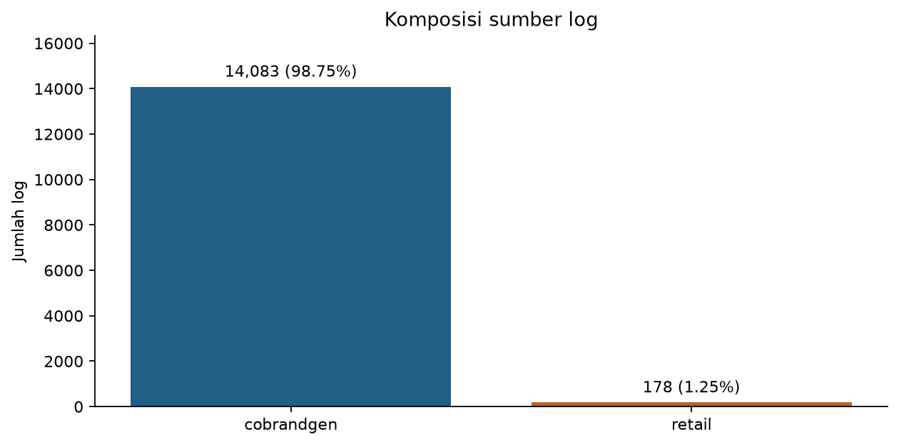
Gambar 3. Komposisi sumber log merupakan bukti EDA tentang ketimpangan populasi, bukan bukti perbedaan tingkat fraud.

Dasar bukti: [ringkasan sumber](../outputs/tables/source_summary.csv), [profil kolom](../outputs/tables/column_profile.csv), dan [manifest sumber](../outputs/reports/source_manifest.json).

## D. Grain dan ketertelusuran

Satu baris log belum tentu satu pembayaran atau satu transaksi bisnis yang berdiri sendiri. Terdapat 9.763 transaction_id berbeda pada cobrandgen dan 51 pada retail, jauh lebih sedikit daripada jumlah baris masing-masing kanal.
Tidak ditemukan duplikasi seluruh baris, termasuk setelah row key dikeluarkan menurut pemeriksaan audit.
Menghapus semua pengulangan transaction_id akan menghilangkan informasi riwayat yang mungkin sah.

Log_key analitik dibentuk dari kanal dan posisi rekaman sumber; pasangan source/source_row_number juga unik. Account_key dan reference_key adalah surrogat untuk grouping dalam namespace sumber.
Manifest SHA-256 dan dim_source menelusurkan fakta ke versi berkas. Urutan rekaman berarti posisi hasil pembacaan CSV, bukan selalu nomor baris fisik apabila suatu field memakai newline.

Grain harus tetap eksplisit ketika menghitung indikator. COUNT baris log, COUNT DISTINCT referensi, dan COUNT DISTINCT akun menjawab pertanyaan berbeda.
Join ke skor harus membatasi run agar satu log tidak terhitung kembali untuk setiap model.

Dasar bukti: [pengulangan identifier secara agregat](../outputs/tables/repetition_summary.csv), [ringkasan sumber](../outputs/tables/source_summary.csv), dan [arsitektur aktual](architecture_and_experiments.md).

## E. Audit dan rekonsiliasi

Audit memeriksa skema, missing, keterbacaan waktu, statistik harga, status, pengulangan, konsistensi temporal, serta kandidat relasi katalog.
Rekonsiliasi status, harga, dan tren harian masing-masing kembali ke 14.261 log. Seluruh timestamp nonmissing berhasil diparse dengan aturan yang didokumentasikan.
Hash input tetap sama setelah audit dan setelah pemodelan; transformasi tidak menimpa sumber.

Mart aktual berisi 14.261 fact_log, 9.326 fact_account_snapshot, dan 42.783 fact_anomaly_scores. Jumlah skor adalah tiga model untuk setiap log.
Terdapat enam baseline run secara total: dua kanal dikalikan tiga model. Pemeriksaan foreign key tidak menemukan pelanggaran dan seluruh parameters_json run valid sebagai JSON.

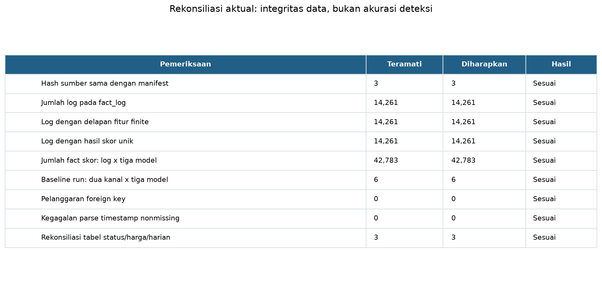
Gambar 12. Rekonsiliasi jumlah, matriks fitur, skor, dan integritas sumber/mart merupakan bukti komputasi; gambar ini tidak mengukur akurasi deteksi.

Audit teknis menunjukkan konsistensi terhadap pemeriksaan yang dilakukan. Ia tidak membuktikan bahwa ekspor lengkap atau makna setiap kolom telah dikonfirmasi pemilik data.

Dasar bukti: [validasi audit](../outputs/reports/audit_validation.json), [validasi pipeline](../outputs/reports/pipeline_validation.json), dan [verifikasi implementasi](../outputs/reports/implementation_verification.md).

## F. Missing dan kelayakan atribut

Pada cobrandgen, package_name, skup, pricing, dan sec_ch seluruhnya kosong. Pada retail, email dan sec_ch seluruhnya kosong.
User_agent dan IP missing pada 12.083 dari 14.083 log cobrandgen, serta 151 dari 178 log retail. Pada bagian yang terisi, user_agent hanya mempunyai satu nilai berbeda dan IP hanya dua nilai berbeda per kanal.
Puid cobrandgen juga hanya mempunyai satu nilai nonmissing yang berbeda. Atribut tersebut tidak memadai untuk menyimpulkan identitas perangkat atau pola jaringan pelanggan.

Retail mempunyai 10 start_date kosong dan 26 cancel_date kosong. Cobrandgen mempunyai 9.280 cancel_date kosong; sebagian besar sesuai status non-CANCEL, sehingga missing harus dibaca bersama konteks status.
Pada katalog, package_type_id kosong pada 43 baris, referensi credential pada 12 baris, dan creator/modifier pada seluruh 90 baris.

Missing tidak diisi dengan nol atau nilai rata-rata. Kolom pribadi, kredensial, dan identifier juga tidak dimasukkan ke model hanya karena terisi.
Kelayakan atribut memerlukan gabungan cakupan, variasi, makna, dan availability, bukan sekadar tipe numerik.

Dasar bukti: [profil kolom](../outputs/tables/column_profile.csv), [kualitas timestamp](../outputs/tables/timestamp_quality.csv), dan [kamus fitur](feature_dictionary.md).

## G. Timestamp dan makna waktu

Timestamp sumber memakai hari/bulan/tahun, offset +00, dan banyak literal `.-1f`. Parser menghapus literal tersebut secara terbatas, menormalkan offset, dan menghasilkan UTC tanpa mengarang pecahan detik.
Pada created_at, koreksi artefak dilakukan untuk 14.070 nilai cobrandgen dan seluruh 178 nilai retail; kegagalan parsing nonmissing setelah normalisasi adalah nol.

| Kanal | created_at minimum UTC | created_at maksimum UTC |
| --- | --- | --- |
| Cobrandgen | 2026-05-11 06:34:25 | 2026-08-07 06:50:58 |
| Retail | 2025-09-18 02:21:56 | 2026-08-02 00:14:57 |

Urutan CSV tidak kronologis: terdapat 4.211 penurunan waktu bersebelahan pada cobrandgen dan 44 pada retail. Perhitungan riwayat karena itu mengurutkan waktu secara eksplisit.
Created_at belum dipastikan sebagai waktu kejadian bisnis, waktu pemrosesan, atau waktu penyisipan. Keberhasilan parsing tidak menyelesaikan pertanyaan semantik tersebut.
Pelaporan saat ini memakai UTC; perubahan ke WIB harus mengubah agregasi serta label secara konsisten.

Dasar bukti: [kualitas timestamp](../outputs/tables/timestamp_quality.csv), [pemeriksaan temporal](../outputs/tables/temporal_checks.csv), dan [konfigurasi audit](../outputs/reports/audit_config.json).

## H. Volume dan pola temporal

Cobrandgen memuat satu log pada Mei 2026, 3.521 pada Juni, 8.578 pada Juli, dan 1.983 pada Agustus. Angka Agustus hanya mencakup bagian periode sampai batas snapshot.
Retail sangat terkonsentrasi pada April 2026 dengan 154 dari 178 log; bulan lain yang teramati mempunyai volume jauh lebih kecil.
Perbedaan ini tidak cukup untuk menyimpulkan pertumbuhan, penurunan penjualan, atau musim fraud karena kelengkapan ekspor dan panjang periode belum sebanding.

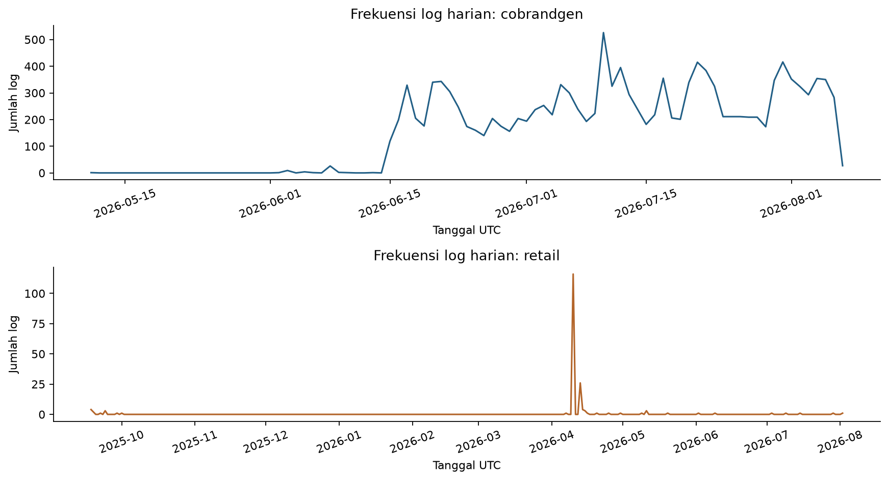
Gambar 2. Tren harian merupakan bukti EDA atas log yang teramati; tidak adanya baris tidak membuktikan tidak adanya aktivitas produksi.

Tabel daily_counts mengisi tanggal di antara batas sumber untuk membantu melihat hari tanpa log. Nol pada deret tersebut merupakan jumlah observasi dalam ekspor, bukan konfirmasi sistem operasional tidak aktif.
Batas awal sumber juga tidak otomatis menjadi tanggal akun mulai aktif. Warm-up berdasarkan selisih hari saja dapat tampak cukup meskipun populasi awal sangat jarang.

Dasar bukti: [jumlah harian](../outputs/tables/daily_counts.csv), [kualitas timestamp](../outputs/tables/timestamp_quality.csv), dan [laporan audit](../outputs/reports/data_audit_report.md).

## I. Nilai tercatat dan batas pendapatan

| Statistik amount | Cobrandgen | Retail |
| --- | ---: | ---: |
| Minimum / median / maksimum | 1.000 / 15.000 / 500.000 | 0 / 15.000 / 500.000 |
| Mean | 14.982,3901 | 24.123,0337 |
| Jumlah nominal | 210.997.000 | 4.293.900 |
| Nilai nol / negatif / tidak valid | 0 / 0 / 0 | 8 / 0 / 0 |

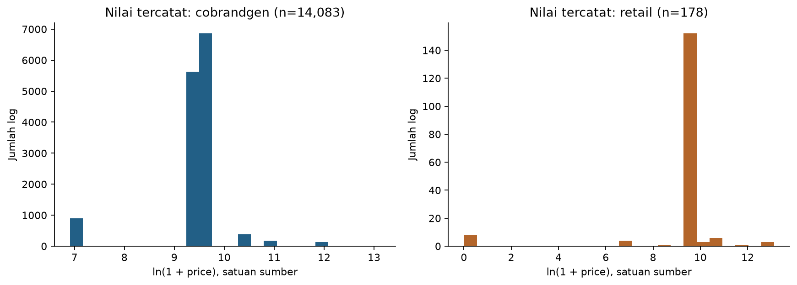
Gambar 1. Distribusi logaritmik nilai adalah bukti EDA; transformasi membantu membaca ekor tanpa menghapus nilai ekstrem.

Cobrandgen mempunyai 11 nilai harga berbeda dan retail delapan. Total nominal gabungan adalah 215.290.900 dalam satuan sumber; mata uang, pajak, diskon, refund, serta keberhasilan pembayaran belum dikonfirmasi.
Sebanyak 702 log cobrandgen dan 13 retail melampaui fence atas IQR. Pada retail Q1 dan Q3 sama-sama 15.000 sehingga fence juga 15.000; hitungan itu sensitif terhadap harga diskret, bukan bukti penyimpangan bisnis.
Harga tinggi dapat mengikuti paket atau durasi sah, sedangkan nol dapat berasal dari promosi atau kondisi lain. Tanpa rekonsiliasi pembayaran, SUM(amount) tetap disebut nilai tercatat.

Dasar bukti: [ringkasan harga](../outputs/tables/price_summary.csv), [distribusi harga](../outputs/tables/price_distribution.csv), dan [interpretasi audit](data_audit_interpretation.md).

## J. Status dan konsistensi langganan

| Status snapshot | Cobrandgen | Retail |
| --- | ---: | ---: |
| ACTIVE | 9.270 | 16 |
| CANCEL | 4.806 | 152 |
| PENDING | 1 | 10 |
| FAILED | 6 | 0 |

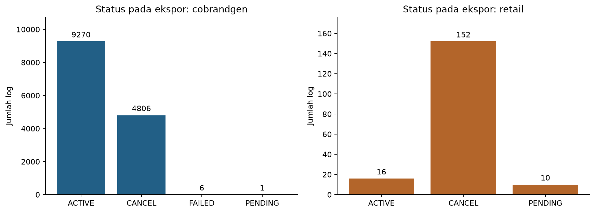
Gambar 4. Status merupakan kategori baris snapshot, bukan label fraud, pembayaran, atau churn final.

Tepat tiga CANCEL cobrandgen tidak mempunyai tanggal pembatalan; seluruh 152 CANCEL retail mempunyai tanggalnya. Ini adalah prioritas pemeriksaan kualitas, bukan putusan fraud.
Start sebelum created ditemukan pada 4.545 log cobrandgen dan 127 retail; cancel setelah expiry pada 1.804 dan satu log. Updated sebelum created, expiry sebelum start, serta cancel sebelum start tidak ditemukan pada observasi yang eligible.
Pembaruan langganan, masa tenggang, dan pencatatan sesudah kejadian merupakan kemungkinan yang harus dikonfirmasi. Status dan tanggal langganan tidak dipakai sebagai fitur inti karena availability historisnya belum terbukti.

Dasar bukti: [jumlah status](../outputs/tables/status_counts.csv), [pemeriksaan temporal](../outputs/tables/temporal_checks.csv), dan [interpretasi audit](data_audit_interpretation.md).

## K. Akun dan pengulangan referensi

Cobrandgen mempunyai 9.285 akun; 5.182 hanya satu log, 443 sedikitnya tiga log, dan 37 sedikitnya lima. Retail mempunyai 41 akun; 34 hanya satu log dan tiga akun menyumbang 135 dari 178 log.
Konsentrasi retail membuat pola beberapa akun sangat berpengaruh. Banyaknya baris tidak dapat dianggap sebagai banyaknya pelanggan independen.

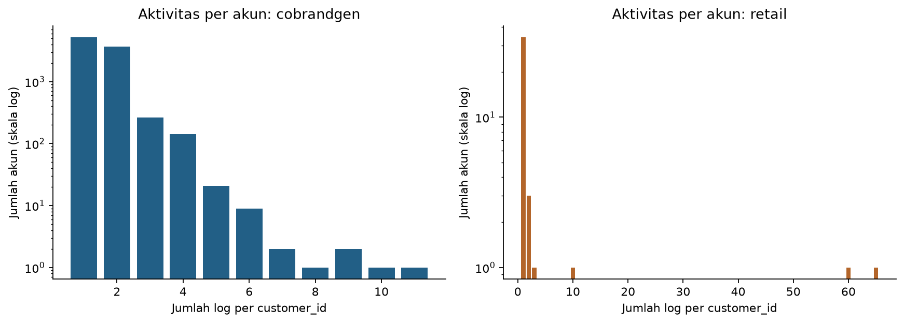
Gambar 5. Distribusi akun menunjukkan riwayat yang jarang pada banyak akun dan konsentrasi yang kuat pada retail.

Terdapat 3.808 kelompok referensi berulang pada cobrandgen, mencakup 8.128 baris dan maksimum sembilan baris per referensi. Retail mempunyai enam kelompok, mencakup 133 baris dan maksimum 64.
Pada setiap kelompok berulang, customer, pricing, dan price tetap. Seluruh kelompok mempunyai expiry yang berubah; status bervariasi pada 3.758 kelompok cobrandgen dan lima retail.

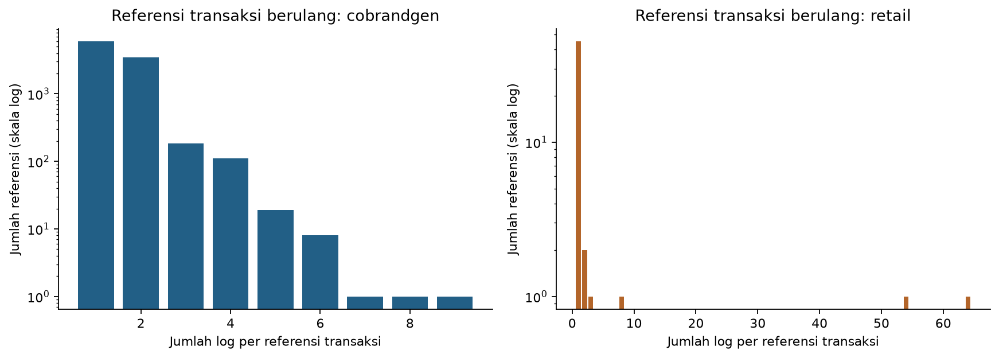
Gambar 6. Pengulangan merupakan bukti struktur log yang perlu dipahami sebagai riwayat; pengulangan identifier tidak otomatis duplikasi pembayaran.

Pola tersebut konsisten dengan kemungkinan riwayat atau renewal, tetapi belum membuktikan salah satunya. Penghapusan pengulangan akan mengubah grain dan harus menunggu definisi pemilik data.

Dasar bukti: [riwayat akun](../outputs/tables/account_history.csv), [distribusi aktivitas akun](../outputs/tables/account_activity_distribution.csv), [pengulangan](../outputs/tables/repetition_summary.csv), dan [pemeriksaan temporal](../outputs/tables/temporal_checks.csv).

## L. Interval dan aktivitas serentak

Audit interval berurutan per akun menghasilkan 4.798 interval cobrandgen tanpa interval nol dan 137 interval retail dengan 13 interval nol. Retail mempunyai 13 kelompok akun/timestamp serentak yang mencakup 26 baris.
Median interval audit adalah 2.591.880 detik pada cobrandgen dan 69 detik pada retail. Rentang dan konsentrasi kanal berbeda, sehingga median tersebut tidak boleh langsung dibaca sebagai frekuensi pembelian pelanggan.

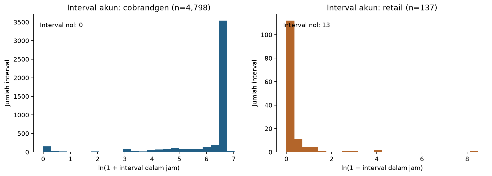
Gambar 7. Interval merupakan bukti EDA mengenai pencatatan yang teramati; gambar bukan validasi bahwa lonjakan tertentu adalah serangan otomatis.

Interval nol dapat berasal dari proses batch, beberapa rekaman sah, atau presisi timestamp sampai detik. Urutan baris pada waktu sama tidak memberikan bukti urutan kejadian yang lebih rinci.
Interval audit berurutan dapat bernilai nol, sedangkan seconds_since_previous_log fitur memakai timestamp yang strictly earlier; keduanya mempunyai definisi berbeda.
Observasi pertama tidak diberi interval nol: bukti interval tetap missing agar ketiadaan riwayat tidak disamakan dengan kejadian serentak.

Dasar bukti: [riwayat dan interval audit](../outputs/tables/account_history.csv), [kamus fitur](feature_dictionary.md), dan [interpretasi audit](data_audit_interpretation.md).

## M. Katalog dan relasi yang belum tervalidasi

Pricing_id log retail maupun cobrandgen tidak mempunyai kecocokan exact dengan package.id. Package_name dan skup cobrandgen tidak menyediakan nilai yang dapat diuji karena seluruhnya kosong.
Dengan demikian, tidak ada join katalog yang tervalidasi dari tiga berkas ini. Hasil tersebut tidak membuktikan tidak ada relasi bisnis; tabel pricing atau pemetaan yang benar mungkin belum disertakan.

Katalog mempunyai 90 id dan code unik, tetapi nama dan atribut produk lain tidak seluruhnya unik. Sebanyak 11 paket mempunyai deleted_at; histori paket terhapus dapat tetap relevan terhadap log lama.
Penggabungan berdasarkan kemiripan nama, harga, atau durasi akan menciptakan hubungan yang belum terbukti dan berpotensi menggandakan fact.
Aturan harga per paket serta selisih durasi aktual karena itu belum digunakan sebagai dasar anomali bisnis.

Dasar bukti: [uji join katalog](../outputs/tables/catalog_join_checks.csv), [profil kolom](../outputs/tables/column_profile.csv), dan [arsitektur aktual](architecture_and_experiments.md).

## N. Privasi dan batas distribusi artefak

Identifier asli hanya digunakan sementara untuk grouping. Surrogat akun/referensi berasal dari kemunculan pertama dalam namespace kanal dan tidak memakai hash identifier, HMAC, atau kunci rahasia.
Tidak ada pemetaan balik yang diekspor. Pseudonim dapat berubah jika urutan snapshot berubah dan tidak boleh dianggap sebagai identitas stabil lintas ekspor atau anonimisasi formal.

Waktu, nilai, dan riwayat rinci tetap dapat bersifat sensitif meskipun identifier telah diganti. Keluaran tersanitasi tidak otomatis layak dipublikasikan sebagai data terbuka.
Ruang lingkup distribusi repositori GitHub dibatasi pada akses private dengan kode inti, konfigurasi, dokumentasi, dan bukti agregat seperlunya.
Sumber mentah, processed data, keluaran per log, model biner, environment, dan cache dikecualikan; status private tidak menggantikan pemilihan artefak minimum.

Status akses private, isi commit, dan keterjangkauan repositori diverifikasi secara terpisah dari validitas hasil analitik. Keberhasilan publikasi kode tidak menjadi bukti ketepatan model.

Dasar bukti: [kebijakan surrogat dan artefak](feature_dictionary.md), [arsitektur](architecture_and_experiments.md), dan [ringkasan konversi](course_conversion_summary.md).

## O. Pipeline dan mart dimensional

Pipeline memisahkan audit/EDA, pembentukan fitur, mart, pemodelan, evaluasi, dan pelaporan. Dashboard membaca hasil yang telah dihasilkan, bukan menjalankan fit ulang ketika filter berubah.
SQLite terpisah memakai dim_source, dim_date, dim_channel, dim_status_snapshot, dan dim_account; fact_log bergrain log dan fact_account_snapshot bergrain akun/cutoff.
Dim_model serta dim_run melengkapi fact_anomaly_scores dengan grain log_key/run_key dan metadata parameter.

Skema aktual mempunyai dua sumber, dua kanal, empat status, 9.326 akun, tiga model, serta enam baseline run total. FK dan batas unik mencegah penggandaan identitas fakta pada mart.
Skor individual menyimpan raw_score, percentile, dan anomaly_rank. Prioritas konsensus bukan kolom fact skor; ia tersimpan pada CSV hasil.
Snapshot akun tidak boleh dijumlahkan sebagai transaksi tambahan atau ditempelkan sebagai riwayat masa lalu pada seluruh log akun.

Rerun membangun kembali mart dan menghapus skor/model/run lama sebelum regenerasi. Source_sha256 dan relative_path membantu memastikan skor baru ditelusurkan ke versi sumber yang benar.

Dasar bukti: [arsitektur dan SQL aktual](architecture_and_experiments.md), [kamus fitur](feature_dictionary.md), [validasi pipeline](../outputs/reports/pipeline_validation.json), dan [verifikasi mart](../outputs/reports/implementation_verification.md).

## P. Fitur dan kontrak strict history

Untuk log pada t, riwayat akun memenuhi `created_at < t`; jendela w adalah `[t-w, t)`. Baris dengan timestamp sama berbagi riwayat yang sama dan tidak saling menambah count atau median kanal.
Hitungan mengukur kejadian yang teramati dalam snapshot, bukan riwayat penuh sepanjang hidup akun. Nol riwayat teramati sah, sedangkan nilai yang tidak dapat diketahui tetap missing.

Delapan fitur inti berikut menggabungkan nilai, aktivitas teramati, pengulangan referensi, dan waktu. Notasi n24/n7 menyatakan jumlah log akun-kanal pada jendela terkait, r jumlah referensi-kanal sebelum t, h waktu harian dalam jam pecahan, dan d hari UTC dengan Senin bernilai nol.

| Fitur | Formula | Sumber | Alasan penggunaan |
| --- | --- | --- | --- |
| log1p_amount | ln(1 + amount) | Price nonnegatif saat snapshot. | Mengurangi dominasi skala nilai yang berekor panjang. |
| log1p_prior_account_count_24h | ln(1 + n24) | Log akun pada [t−24 jam, t). | Mewakili aktivitas jangka pendek yang teramati. |
| log1p_prior_account_count_7d | ln(1 + n7) | Log akun pada [t−7 hari, t). | Memberi konteks aktivitas pada horizon lebih panjang. |
| log1p_prior_reference_count | ln(1 + r) | Referensi sama dengan created_at < t. | Mengukur pengulangan tanpa memasukkan identifier sebagai angka. |
| hour_sin | sin(2πh/24) | Created_at UTC, termasuk menit/detik. | Komponen pertama posisi siklus harian. |
| hour_cos | cos(2πh/24) | Created_at UTC, termasuk menit/detik. | Melengkapi posisi siklus tanpa jarak semu di tengah malam. |
| weekday_sin | sin(2πd/7) | Hari pekan created_at UTC. | Komponen pertama posisi siklus mingguan. |
| weekday_cos | cos(2πd/7) | Hari pekan created_at UTC. | Melengkapi posisi siklus pada batas akhir/awal pekan. |

Versi `2_time_of_day_seconds` memakai hour + minute/60 + second/3600 untuk siklus 24 jam, serta siklus tujuh hari UTC. Menit/detik sumber dipertahankan tanpa jitter, deduplikasi, atau pecahan detik buatan.
Seluruh 14.261 log mempunyai delapan fitur finite. Status, identifier, tanggal langganan, atribut pribadi, dan katalog tidak menjadi input model inti.

Seconds_since_previous_log, median amount kanal strict-prior, selisih amount terhadap median, jumlah riwayat, dan flag coverage menjadi bukti pendamping. Cold start tidak diimputasi untuk memaksakan fitur tersebut ke model.

| Bukti coverage/cold start | Cobrandgen | Retail |
| --- | ---: | ---: |
| Log tanpa riwayat akun yang strictly earlier / interval sebelumnya missing | 9.285 | 42 |
| Log dengan median kanal strict-prior missing | 1 | 1 |
| Log dengan window_24h_complete salah | 1 | 4 |
| Log dengan window_7d_complete salah | 1 | 10 |

Retail mempunyai 42 log cold start dari 41 akun karena observasi pertama dapat serentak. Flag coverage hanya membandingkan elapsed time terhadap timestamp minimum sumber: bernilai benar tidak membuktikan ingestion lengkap atau baseline memadai.
Pengujian memeriksa timestamp serentak dan memastikan tambahan observasi masa depan tidak mengubah fitur terdahulu.
Strict history fitur tidak berarti keseluruhan eksperimen prospektif: model, scaler, persentil, dan statistik penjelasan marginal sekarang tetap menggunakan snapshot fit yang sama.

Dasar bukti: [kamus fitur](feature_dictionary.md), [coverage fitur agregat](../outputs/tables/feature_coverage_summary.csv), [validasi pipeline dan versi fitur](../outputs/reports/pipeline_validation.json), serta [metodologi model](../outputs/reports/model_comparison_report.md).

## Q. Snapshot akun dan kecukupan statistik

Cutoff akun adalah maksimum created_at sumber ditambah satu detik: retail 2026-08-02 00:14:58 UTC dan cobrandgen 2026-08-07 06:50:59 UTC.
Sebanyak 9.326 snapshot merangkum seluruh log berwaktu diketahui sebelum cutoff masing-masing sumber. Tidak ada window_days rolling pada fact_account_snapshot.

Statistiknya mencakup jumlah log/referensi teramati, jumlah amount diketahui, mean, std sampel dengan ddof=1, timestamp unik, dan batas observasi akun/sumber.
Std satu observasi tidak terdefinisi; 5.182 singleton cobrandgen dan 34 singleton retail tetap tidak memiliki std sampel, bukan diberi nilai nol.
Median interval hanya tersedia jika sedikitnya tiga timestamp unik; banyak log pada waktu yang sama tidak otomatis memenuhi syarat tersebut.

Rentang observasi akun tidak sama dengan umur akun dan rentang sumber bukan jaminan kelengkapan produksi. Fitur snapshot full-source juga tidak boleh menjadi input log masa lalu karena akan membawa masa depan.
Model akun tidak dipaksakan: riwayat jarang, dominasi beberapa akun retail, perbedaan paparan waktu, dan ketiadaan label menghalangi kesimpulan metodologis yang kuat.

Dasar bukti: [riwayat akun](../outputs/tables/account_history.csv), [validasi jumlah snapshot](../outputs/reports/pipeline_validation.json), dan [definisi snapshot](feature_dictionary.md).

## R. Mekanisme dan konfigurasi model

Isolation Forest memilih fitur dan batas split secara acak untuk membentuk kumpulan pohon. Observasi yang terisolasi melalui lintasan lebih pendek dipandang lebih tidak biasa; rata-rata lintasan menggabungkan bukti dari beberapa pohon. Implementasi proyek membalik score_samples agar orientasi semua model konsisten. Random seed diperlukan untuk reproduksi partisi, sedangkan jumlah pohon dan ukuran sampel memengaruhi kestabilan hasil. [Dokumentasi primer Isolation Forest](https://scikit-learn.org/stable/modules/generated/sklearn.ensemble.IsolationForest.html).

ECOD membentuk distribusi kumulatif empiris per fitur, menilai posisi pada ekor distribusi, dan menggabungkan bukti antardimensi menjadi skor. Proyek memakai decision_scores_ dari fit snapshot; threshold internal contamination tidak digunakan untuk menetapkan prioritas konsensus. Protokol ini tidak diklaim sebagai penilaian observasi masa depan terhadap ECDF yang telah dibekukan. [Makalah ECOD](https://arxiv.org/abs/2201.00382), [kode sumber resmi PyOD](https://pyod.readthedocs.io/en/latest/_modules/pyod/models/ecod.html).

LOF membandingkan kepadatan lokal suatu observasi dengan kepadatan tetangga terdekatnya. Observasi pada lingkungan yang relatif lebih renggang dapat memperoleh skor lebih tinggi meskipun tidak ekstrem secara global. Pemilihan k, skala fitur, dan vektor identik memengaruhi lingkungan pembanding. Proyek memakai novelty=False dan kebalikan negative_outlier_factor_ pada data fit, bukan skor novelty untuk data baru. [Dokumentasi primer LOF](https://scikit-learn.org/stable/modules/generated/sklearn.neighbors.LocalOutlierFactor.html).

Ketiganya di-fit per kanal pada snapshot yang sama dengan RobustScaler; seluruh delapan fitur aktif pada kedua kanal dan tidak ada fitur konstan yang dikeluarkan pada hasil aktual.

| Model | Variasi aktual | Skor berorientasi lebih tinggi semakin anomali |
| --- | --- | --- |
| IF | Trees 100/300, seed 11/42/73, max_samples 256/1024 dibatasi jumlah log. | Kebalikan score_samples. |
| ECOD | Satu fit snapshot per kanal. | Decision_scores_ hasil fit. |
| LOF | K 10/20/50, novelty=False. | Kebalikan negative_outlier_factor_. |

Cobrandgen mempunyai 16 varian: 12 IF, satu ECOD, dan tiga LOF. Retail mempunyai 10: enam IF, satu ECOD, dan tiga LOF, karena dua max_samples sama-sama dibatasi menjadi 178 dan konfigurasi identik digabungkan.
Baseline IF adalah 100 trees, seed 11, max_samples 256 pada cobrandgen dan 178 pada retail; baseline LOF k=10. Baseline adalah urutan konfigurasi pertama, bukan hasil pemilihan akurasi.

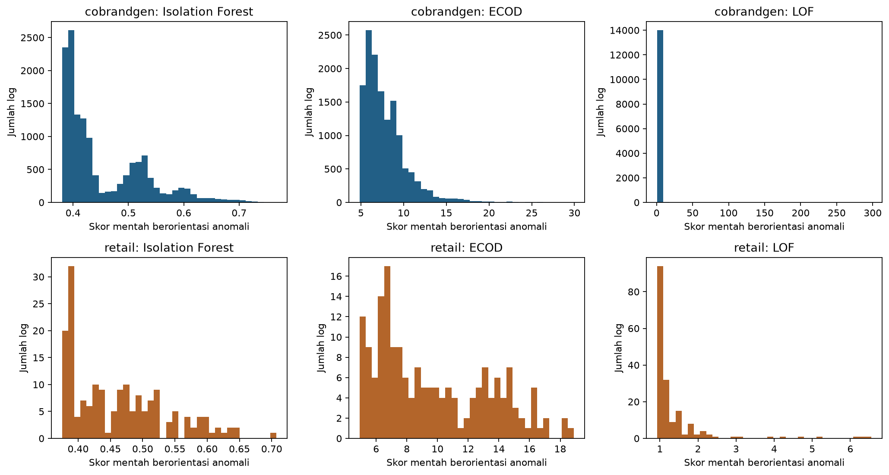
Gambar 8. Distribusi skor merupakan diagnostik model; skala mentah berbeda antarmodel sehingga tinggi histogram atau besarnya skor tidak menunjukkan akurasi yang lebih baik.

| Kanal | Skor | Median | P99 | Maksimum |
| --- | --- | ---: | ---: | ---: |
| Cobrandgen | IF | 0,4195 | 0,6818 | 0,7670 |
| Cobrandgen | ECOD | 7,1986 | 17,3825 | 29,9307 |
| Cobrandgen | LOF | 1,0247 | 3,4174 | 298,1919 |
| Cobrandgen | Konsensus | 0,4954 | 0,9590 | 0,9941 |
| Retail | IF | 0,4509 | 0,6423 | 0,7070 |
| Retail | ECOD | 8,7886 | 18,1851 | 18,8879 |
| Retail | LOF | 1,0727 | 6,1560 | 6,5546 |
| Retail | Konsensus | 0,5309 | 0,9621 | 0,9831 |

P99 adalah kuantil distribusi skor, bukan skor satu kasus yang harus ada persis. LOF maksimum yang jauh lebih besar daripada median menunjukkan ekor skor yang panjang; besaran itu tidak boleh dibandingkan langsung dengan skala IF/ECOD atau ditafsirkan sebagai probabilitas.

Vektor identik dipertahankan: cobrandgen mempunyai 11.514 vektor berbeda, 1.815 kelompok berulang yang mencakup 4.384 baris, maksimum tujuh identik; retail 164 vektor berbeda, 14 kelompok/28 baris, maksimum dua.
LOF k=10/20/50 tidak memerlukan penyesuaian pada run akhir dan tidak menghasilkan warning incorrect-results. Ketiadaan warning bukan validasi ketepatan model; sensitivitas tetap perlu dibaca.

Dasar bukti: [parameter aktual](../outputs/tables/experiment_parameters.csv), [ringkasan distribusi skor](../outputs/tables/score_summary.csv), [diagnostik vektor dan LOF](../outputs/reports/model_evaluation.json), dan [laporan model](../outputs/reports/model_comparison_report.md).

## S. Rumus evaluasi dan penanganan ties

Evaluasi utama adalah retrospective_in_sample: model menilai observasi yang digunakan untuk fit. Tidak ada temporal holdout atau ground truth hasil investigasi.
Jika A dan B adalah himpunan Top-K pada log_key yang sama, overlap adalah `|A irisan B| / K`, sedangkan Jaccard adalah `|A irisan B| / |A gabungan B|`.
Spearman adalah korelasi peringkat kedua vektor skor pada observasi yang cocok. Korelasi tidak dihitung pada himpunan log berbeda yang tidak dapat dipasangkan.

Persentil model adalah average rank skor menaik dibagi n, sedangkan anomaly rank individual berorientasi menurun. Korelasi juga menangani ties dengan average ranks.
Top-K dan kuota prioritas menggunakan urutan log_key sebagai pemecah tie deterministik; urutan itu tidak membawa makna risiko bisnis.
Tabel threshold mencatat jumlah ties di batas sehingga filter nilai dapat dibedakan dari pemilihan tepat K baris.

K yang sama mempunyai proporsi populasi berbeda antarkanal. Agreement Top-50 retail tidak langsung sebanding dengan Top-50 cobrandgen karena penyebut kanal sangat berbeda.
Tanpa label, agreement dan stabilitas hanya mengukur konsistensi. Accuracy, precision, recall, F1, dan ROC-AUC untuk anomali nyata tidak dihitung.

Dasar bukti: [agreement](../outputs/tables/model_agreement.csv), [stabilitas](../outputs/tables/model_stability.csv), [threshold](../outputs/tables/threshold_sensitivity.csv), dan [protokol metadata](../outputs/reports/model_evaluation.json).

## T. Hasil agreement tiga pasangan model

| Kanal | Pasangan | Spearman | Irisan Top-25 | Jaccard Top-25 |
| --- | --- | ---: | ---: | ---: |
| Cobrandgen | IF–ECOD | 0,8309 | 13/25 | 0,3514 |
| Cobrandgen | IF–LOF | 0,1028 | 0/25 | 0,0000 |
| Cobrandgen | ECOD–LOF | 0,1012 | 0/25 | 0,0000 |
| Retail | IF–ECOD | 0,8100 | 17/25 | 0,5152 |
| Retail | IF–LOF | 0,4717 | 9/25 | 0,2195 |
| Retail | ECOD–LOF | 0,3469 | 10/25 | 0,2500 |

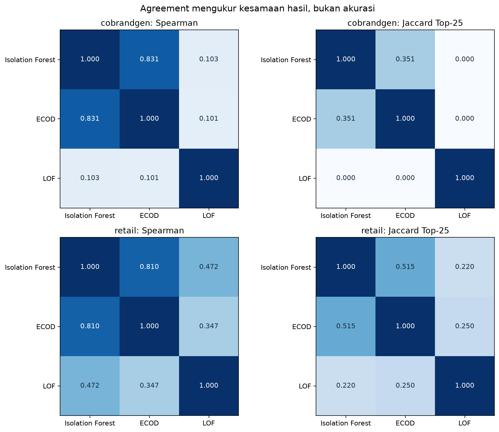
Gambar 9. Spearman dan Jaccard Top-25 menunjukkan kesamaan ranking, bukan persentase deteksi yang benar.

IF dan ECOD relatif selaras secara global, tetapi tidak menghasilkan antrean teratas yang identik. Pada cobrandgen keduanya beririsan enam dari Top-10 dan 34 dari Top-50; pada retail lima dan 39.
Pada cobrandgen, LOF tidak beririsan dengan IF maupun ECOD pada Top-10, Top-25, maupun Top-50. Perbedaan ini mendukung pemeriksaan kasus yang hanya ditonjolkan LOF, bukan penghapusan otomatis hasilnya.
Kesepakatan model dapat membantu menyusun antrean, sedangkan perbedaan dapat membuka sudut pandang baru. Tidak satu pun merupakan pengganti pemeriksaan bisnis atau label tervalidasi.

Dasar bukti: [seluruh hasil agreement](../outputs/tables/model_agreement.csv) dan [pembahasan model](../outputs/reports/model_comparison_report.md).

## U. Stabilitas parameter dan subsampel

| Kanal / model | Mean Spearman variasi parameter/seed | Minimum | Maksimum |
| --- | ---: | ---: | ---: |
| Cobrandgen IF | 0,9701 | 0,9506 | 0,9892 |
| Cobrandgen LOF | 0,4052 | 0,2644 | 0,5460 |
| Retail IF | 0,9831 | 0,9773 | 0,9918 |
| Retail LOF | 0,5880 | 0,3992 | 0,7767 |

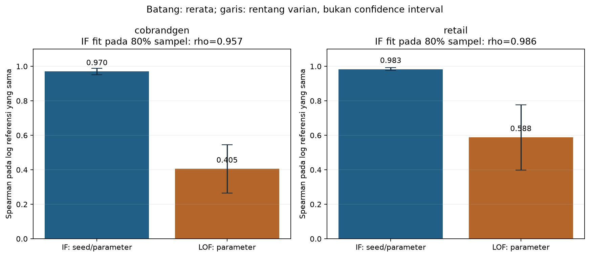
Gambar 10. Stabilitas parameter/seed dan uji subsampel IF merupakan diagnostik berbeda dan disajikan terpisah; keduanya bukan akurasi.

IF lebih konsisten dalam grid ini, tetapi variasinya mencampurkan seed, jumlah trees, dan max_samples; LOF hanya memvariasikan k. ECOD tidak diberi eksperimen seed semu karena implementasinya deterministik dalam protokol ini.
Setiap pasangan konfigurasi muncul pada beberapa K, sehingga baris Spearman yang berulang untuk K berbeda bukan ulangan eksperimen independen.

Pemisahan IF berikut dihitung dari varian unik, dengan baseline tetap: seed-only mempertahankan trees/max_samples; parameter-only mempertahankan seed 11. Ini bukan estimasi efek kausal setiap hiperparameter.

| Kanal | Mean Spearman seed-only / jumlah perbandingan | Mean Spearman parameter-only / jumlah perbandingan |
| --- | --- | --- |
| Cobrandgen | 0,9592 / 2 | 0,9857 / 3 |
| Retail | 0,9781 / 2 | 0,9918 / 1 |

Varian lain sekaligus mengubah seed dan parameter, sehingga tidak dilabeli sebagai seed-only. Angka terpisah ini menjelaskan mengapa satu mean gabungan tidak boleh disebut sebagai seluruhnya stabilitas seed.

Uji subsampel IF melatih pada 80% tanpa replacement: 11.266 log cobrandgen dan 142 retail, lalu menilai set referensi snapshot penuh yang sama.
Spearman terhadap baseline adalah 0,9573 dan 0,9862. Irisan Top-10/25/50 masing-masing 7/20/44 untuk cobrandgen serta 7/22/46 untuk retail.
Set referensi masih tumpang tindih dengan train; hasil itu mengukur sensitivitas subsampel, bukan performa holdout atau generalisasi temporal.

Dasar bukti: [stabilitas aktual](../outputs/tables/model_stability.csv), [parameter](../outputs/tables/experiment_parameters.csv), dan [batas protokol](../outputs/reports/model_evaluation.json).

## V. Threshold dan kapasitas konsensus

Konsensus adalah rerata tiga persentil dalam kanal. Ia bukan model terlatih keempat dan tidak dikalibrasi sebagai probabilitas fraud.
Aturan kapasitas memakai `ceil(p × n)` dengan prioritas tinggi 1%, sedang sampai kumulatif 5%, dan rendah sisanya.

| Kanal | Kuota 1% / 2% / 5% / 10% | Tinggi / sedang / rendah |
| --- | --- | --- |
| Cobrandgen | 141 / 282 / 705 / 1.409 | 141 / 564 / 13.378 |
| Retail | 2 / 4 / 9 / 18 | 2 / 7 / 169 |

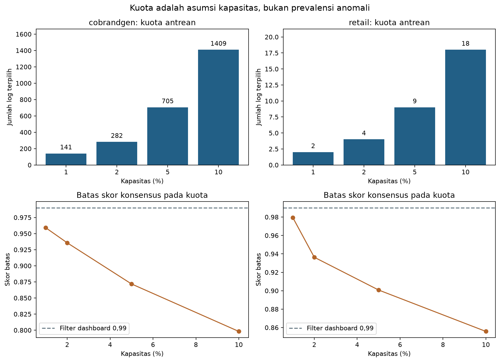
Gambar 11. Jumlah terpilih merupakan konsekuensi mekanis kuota; perubahan boundary konsensus tidak menunjukkan perubahan prevalensi fraud.

Boundary konsensus pada kuota 1%/2%/5%/10% adalah 0,9590/0,9357/0,8718/0,7981 untuk cobrandgen dan 0,9794/0,9363/0,9007/0,8558 untuk retail.
Jumlah tinggi gabungan 143 adalah alokasi kerja, bukan 143 fraud. Ties dapat membuat filter skor memilih jumlah berbeda: pada IF retail kuota 2% memilih empat baris, tetapi boundary mempunyai tiga baris di atas dan dua terikat sehingga filter >= boundary memilih lima.
Rerata persentil bukan persentil ulang konsensus. Karena itu threshold dashboard tidak boleh disamakan dengan kuota ranking atau dianggap otomatis memilih persentase tertentu.

| Skor pada threshold 0,99 | Cobrandgen memenuhi threshold | Retail memenuhi threshold |
| --- | ---: | ---: |
| Persentil IF | 141 | 2 |
| Persentil ECOD | 141 | 2 |
| Persentil LOF | 141 | 2 |
| Rerata persentil konsensus | 10 | 0 |

Maksimum konsensus retail adalah 0,9831460674, lebih rendah daripada 0,99, walaupun kuota tinggi retail tetap dua log. Perbedaan tersebut adalah akibat definisi skor/filter dan bukan kegagalan data atau bukti tidak adanya risiko retail.

Dasar bukti: [sensitivitas threshold dan ties](../outputs/tables/threshold_sensitivity.csv), [jumlah pada threshold dashboard](../outputs/tables/dashboard_threshold_counts.csv), [ringkasan skor](../outputs/tables/score_summary.csv), [kebijakan prioritas](../outputs/reports/model_evaluation.json), dan [laporan model](../outputs/reports/model_comparison_report.md).

## W. Penjelasan statistik dan investigasi

Penjelasan menghubungkan log berperingkat dengan bukti yang dapat dihitung ulang: nilai terhadap median kanal strict-prior, jumlah log historis, pengulangan referensi, cold start, dan coverage jendela.
Pemeriksaan ekor marginal menggunakan distribusi snapshot kanal. Bukti pola waktu menjelaskan posisi komponen siklik, bukan klaim bahwa frekuensi jam tertentu telah diuji sebagai pola fraud.

Alasan tersebut merupakan penjelasan statistik deskriptif. Ia bukan SHAP, bukan dekomposisi kontribusi model, dan bukan hubungan sebab-akibat.
Log yang diprioritaskan oleh kombinasi model dapat tidak mempunyai satu deviasi marginal ekstrem; kondisi itu harus dinyatakan tanpa menciptakan alasan yang tidak dihitung.

Tindak lanjut yang sah adalah meninjau konteks akun, memeriksa bukti pembayaran/proses, dan meminta penjelasan pemilik data. Hasil tinjauan perlu dicatat sebelum dipakai sebagai label evaluasi.
Dokumen knowledge tidak menampilkan kasus per log agar pembahasan tetap agregat dan sesuai batas distribusi.

Dasar bukti: [metodologi penjelasan](../outputs/reports/model_comparison_report.md), [kamus fitur](feature_dictionary.md), dan [batas interpretasi](data_audit_interpretation.md).

## X. Dashboard dan bukti validasi

| Halaman | Cakupan utama |
| --- | --- |
| Executive Overview | Jumlah log/akun, nilai tercatat, kanal, status snapshot, dan tren. |
| Anomaly Monitoring | Distribusi skor dan log yang melampaui threshold terpilih. |
| Model Comparison | Parameter, agreement, stabilitas, dan sensitivitas pada snapshot kanal. |
| Transaction Investigation | Ranking, alasan, bukti, dan konteks akun pseudonim. |

Filter tidak melakukan fit ulang. Persentil tetap berasal dari snapshot kanal; tabel evaluasi mengikuti kanal terpilih tetapi tidak seluruh filter tanggal/status. Konteks akun memakai seluruh snapshot agar riwayat tidak terpotong.
Catatan verifikasi implementasi menyatakan 28 pengujian lulus, AppTest empat halaman beserta filter/kondisi kosong, serta respons HTTP 200 server lokal.
Notebook mempunyai tujuh sel kode yang dieksekusi tanpa error. Catatan tersebut adalah rekaman validasi pada pelaksanaan proyek, bukan klaim bahwa semua pemeriksaan diulang setiap kali dokumen dibaca.

Screenshot dashboard browser belum tersedia. Computer Use menghentikan inspeksi karena URL aktif Windows tidak dapat dipastikan; AppTest dan HTTP 200 bukan bukti visual browser.
Gambar 1–7 adalah bukti EDA, gambar 8–11 diagnostik model, dan gambar 12 rekonsiliasi. Seluruhnya harus dibaca sesuai fungsi, bukan dipresentasikan sebagai gambar akurasi atau screenshot aplikasi.

| Indeks dan berkas gambar | Fungsi bukti | Batas interpretasi |
| --- | --- | --- |
| 1 — 01_value_distribution.png | EDA distribusi nilai tercatat. | Bukan pendapatan atau konfirmasi harga salah. |
| 2 — 02_daily_activity.png | EDA volume harian snapshot. | Bukan tren produksi yang dipastikan lengkap. |
| 3 — 03_channel_distribution.png | EDA ketimpangan kanal. | Bukan proporsi fraud per kanal. |
| 4 — 04_activation_status.png | EDA kategori status ekspor. | Bukan churn final atau label fraud. |
| 5 — 05_account_activity.png | EDA riwayat dan konsentrasi akun. | Jumlah log bukan jumlah pembelian independen. |
| 6 — 06_repeated_patterns.png | EDA pengulangan referensi/akun. | Identifier berulang tidak otomatis duplikasi salah. |
| 7 — 07_intertransaction_intervals.png | EDA interval pencatatan. | Interval nol tidak membuktikan otomasi berbahaya. |
| 8 — 08_model_score_distributions.png | Diagnostik distribusi skor. | Skor mentah antarmodel tidak sebanding. |
| 9 — 09_model_agreement.png | Spearman dan Jaccard Top-25. | Agreement bukan akurasi. |
| 10 — 10_model_stability.png | Variasi konfigurasi dan subsampel IF. | Bukan temporal holdout atau kebenaran deteksi. |
| 11 — 11_threshold_sensitivity.png | Kapasitas dan boundary konsensus. | Jumlah terpilih mekanis, bukan prevalensi. |
| 12 — 12_data_validation.png | Rekonsiliasi sumber, fitur, skor, dan mart. | Integritas teknis bukan validitas fraud. |

Gambar 9–12 telah dihasilkan dan diinspeksi sebagai grafik bukti, bukan gambar UI buatan. Indeks di atas melengkapi caption dan tautan inline pada bagian terkait.

Dasar bukti: [verifikasi implementasi dan batas browser](../outputs/reports/implementation_verification.md), [validasi pipeline](../outputs/reports/pipeline_validation.json), dan [arsitektur dashboard](architecture_and_experiments.md).

## Y. Keterbatasan dan rekomendasi

Keterbatasan utama adalah label fraud belum tersedia, pembayaran belum direkonsiliasi, grain dan availability atribut belum sepenuhnya dikonfirmasi, katalog belum mempunyai mapping, serta jendela ekspor berbeda dan mungkin tidak lengkap.
Model memakai snapshot fit yang sama untuk preprocessing/scoring; evaluasi temporal belum dilakukan. ECOD referensi beku, LOF novelty, stress test sintetis, dan model akun belum menjadi hasil proyek.
Duplikasi vektor tetap ada meskipun presisi waktu ditingkatkan; maksimum aktual cobrandgen tujuh dan retail dua. Tidak ada jitter atau deduplikasi untuk memperbaiki tampilan statistik secara artifisial.

IF dapat dipertahankan sebagai baseline retrospektif karena stabil pada grid yang diuji. ECOD menjadi pembanding yang relatif selaras, sedangkan LOF dipertahankan sebagai eksplorasi kepadatan lokal dengan perhatian pada sensitivitasnya.
Konsensus adalah antrean awal yang belum divalidasi dengan keputusan analis. Periksa kasus yang disepakati sekaligus perbedaan model, tanpa menyebut metode tertentu paling akurat.

Prioritas pemilik data adalah mengonfirmasi arti setiap baris, waktu pencatatan, lifecycle status, tiga CANCEL tanpa tanggal, harga/pembayaran/refund, dan mapping pricing-package.
Sesudah itu, rancang temporal replay dengan preprocessing dan kalibrasi hanya dari masa lalu, jaga timestamp serentak pada blok yang sama, dan bangun label hasil tinjauan yang sah.

Dasar bukti: [metadata dan rekomendasi aktual](../outputs/reports/model_evaluation.json), [interpretasi audit](data_audit_interpretation.md), dan [rencana yang belum diimplementasikan](architecture_and_experiments.md).

## Z. Reproduksi dan kesimpulan konversi

Jalankan dari folder kecerdasan-bisnis. Lingkungan baru memerlukan Python yang sesuai dan instalasi requirements; pada workspace pelaksanaan virtual environment lokal sudah disiapkan.

```bash
python -m venv .venv
./.venv/Scripts/python.exe -m pip install -r requirements.txt
./.venv/Scripts/python.exe run_pipeline.py
./.venv/Scripts/python.exe build_knowledge_evidence.py
./.venv/Scripts/python.exe -m unittest discover -s tests -v
./.venv/Scripts/python.exe -m streamlit run "../DEPLOYMENT_KECERDASAN BISNIS/app.py" --server.address 127.0.0.1 --server.port 8501 --server.headless true --browser.gatherUsageStats false
```

Konfigurasi audit menentukan sumber dan parser, sedangkan konfigurasi eksperimen menentukan grid serta aturan evaluasi. Rerun mengganti keluaran analitik/model dan membangun ulang mart; sumber mentah tidak ditimpa.
Reproduksi hasil aktual memerlukan akses sah ke sumber yang sama. Repositori private minimal yang mengecualikan data tidak dengan sendirinya memuat bahan untuk menjalankan ulang semua angka pada komputer lain.
Perintah memakai sintaks path Git Bash pada Windows. Build_knowledge_evidence dijalankan setelah pipeline untuk membentuk tabel agregat tambahan dan grafik bukti, bukan untuk mengganti fit model.
Lingkungan penuh sebelumnya merekam 28 pengujian lulus. Pada fresh clone tanpa sumber dan artefak privat, 19 pengujian lulus dan sembilan dilewati sesuai prasyarat data/integrasi; skipped tidak dilaporkan sebagai pengujian integrasi yang berhasil.

Konversi Kecerdasan Bisnis terwujud melalui audit, ETL, mart dimensional, analitik deskriptif, evaluasi transparan, dan dashboard yang menghubungkan ringkasan dengan investigasi.
Kesimpulan bisnisnya adalah tersedianya sistem pendukung peninjauan yang lebih tertib dan dapat diperiksa, bukan pembuktian fraud atau pendapatan. Nilai proyek bertumpu pada ketertelusuran dan batas interpretasi yang jelas, disertai agenda pengayaan data serta validasi operasional berikutnya.

Dasar bukti: [README dan cara menjalankan](../README.md), [validasi pipeline](../outputs/reports/pipeline_validation.json), [verifikasi implementasi](../outputs/reports/implementation_verification.md), dan [ringkasan konversi](course_conversion_summary.md).
