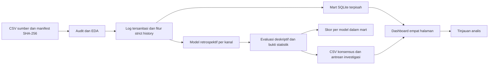

# Arsitektur dan Protokol Eksperimen Norton

Dokumen ini menjelaskan implementasi analitik retrospektif atas snapshot serta eksperimen lanjutan yang belum dikerjakan. Modul audit, fitur, mart, pemodelan, pelaporan, dependensi, dan dashboard sudah tersedia. Keberhasilan eksekusi aktual serta hasil numerik harus dibaca pada laporan keluaran pipeline; keberadaan kode tidak dengan sendirinya membuktikan validasi. Dokumen ini tidak menetapkan model terbaik atau tingkat fraud.

## 1. Dasar keputusan dan ruang lingkup

Sumber yang tersedia adalah 14.083 log cobrandgen, 178 log retail, dan 90 baris katalog package. Database operasional enam tabel dan dokumentasi terdahulu tidak tersedia pada workspace awal. Proyek tidak mengubah struktur database operasional atau menganggap katalog sebagai dimensi yang sudah dapat digabungkan.

Unit observasi model adalah satu baris log sumber. Transaction_id berulang tidak dihapus karena dapat merepresentasikan riwayat layanan; pengulangannya bukan bukti fraud atau pembelian baru. Amount adalah nilai price yang tercatat, bukan pembayaran terkonfirmasi atau pendapatan bersih. Status merupakan snapshot ekspor dan tidak menjadi label fraud maupun status akhir pelanggan.

Jendela created_at kedua kanal berbeda dan riwayat banyak akun sangat pendek. Analisis utama dipisahkan per kanal agar kelangkaan retail tidak menjadi alasan anomali pada model gabungan. Eksperimen retail tetap bersifat eksploratif. Makna created_at, availability amount pada waktu kejadian, dan siklus status masih memerlukan konfirmasi pemilik data.

## 2. Alur Business Intelligence yang diimplementasikan



`run_pipeline.py` mengorkestrasi audit, fitur, penyimpanan mart, tiga model, evaluasi, skor, serta laporan. Artefak berada di folder proyek dan database analitik terpisah pada `data/processed/norton_bi.db`. Dashboard membaca CSV tersanitasi dan hasil evaluasi. Sumber mentah tidak ditimpa dan hash sumber diperiksa oleh tahap audit.

Manifest sumber mencatat nama sumber, jalur relatif, SHA-256, ukuran berkas, jumlah baris, dan jumlah kolom. Konfigurasi serta hasil validasi audit disimpan sebagai artefak laporan. Fact menyimpan source_row_number berbasis satu menurut urutan rekaman CSV, bukan nomor baris fisik atau identifier operasional.

Kolom pribadi dan kredensial dikeluarkan sebelum ekspor analitik. Identifier pelanggan dan transaksi hanya dipakai sementara untuk pengelompokan dalam memori. Account_key dan reference_key adalah surrogat namespace kanal berdasarkan kemunculan pertama dalam snapshot; log_key berasal dari kanal dan urutan rekaman. Tidak ada hash identifier, HMAC, kunci rahasia, atau pemetaan identifier asli yang ditulis ke keluaran.

Surrogat deterministik untuk snapshot dengan urutan yang sama, tetapi bukan identitas stabil lintas snapshot. Seluruh mart dibangun kembali ketika pipeline dijalankan ulang; tabel skor/model/run lama dihapus sebelum regenerasi sehingga skor tidak terbawa ke versi sumber baru. HMAC dengan pengelolaan kunci merupakan pilihan desain produksi di masa depan apabila identitas stabil diperlukan, bukan bagian implementasi sekarang.

## 3. Skema dimensional aktual

| Tabel | Grain, kolom penting, dan relasi |
| --- | --- |
| `dim_source` | Satu sumber pada build saat ini; source, channel, source_rows, batas observasi, source_sha256, relative_path. |
| `dim_date` | Satu tanggal UTC yang mempunyai log; date_utc, year, month, day, weekday. |
| `dim_channel` | Satu kanal, dengan channel sebagai kunci. |
| `dim_status_snapshot` | Satu status_snapshot yang diketahui; bukan histori transisi status. |
| `dim_account` | Satu account_key per kanal, dengan batas waktu observasi dan tanpa atribut pribadi. |
| `fact_log` | Satu log_key; source/source_row_number juga unik; memuat channel, date_utc, account_key, reference_key, created_at, amount, status_snapshot, fitur, dan bukti pendamping. |
| `fact_account_snapshot` | Satu account_key/cutoff_utc; agregat seluruh sumber teramati sebelum cutoff, dengan cakupan akun dan sumber. |
| `dim_model` | Satu model_key dan model_name untuk IF, ECOD, atau LOF. |
| `dim_run` | Satu run_key baseline per kanal/model; model_key, channel, analysis_mode, parameters_json. |
| `fact_anomaly_scores` | Satu log_key/run_key; raw_score, percentile, anomaly_rank; FK ke fact_log dan dim_run. |

Foreign key fakta dasar mengacu pada sumber, tanggal, kanal, status snapshot, dan akun yang sesuai. Hash sumber membuat versi berkas dapat ditelusuri meskipun source tetap berupa nama kanal pada build saat ini. Tidak ada dimensi atau FK package karena mapping pricing ke package belum tervalidasi.

Cutoff snapshot akun adalah `max(created_at sumber) + 1 detik`. Tidak ada kolom window_days: snapshot memakai seluruh observasi sumber sebelum cutoff dan mencatat account_observation_days serta source_observation_days. Snapshot bukan transaksi tambahan dan tidak boleh dijumlahkan dengan fact_log. Snapshot full-source juga tidak boleh digabungkan sebagai fitur historis untuk log sebelumnya.

Skor dalam mart adalah skor baseline individual. Raw_score sudah berorientasi semakin tinggi semakin anomali, percentile memakai average ranks dalam kanal, dan anomaly_rank merupakan peringkat model pada set snapshot. Prioritas investigasi dan konsensus tidak menjadi kolom fact_anomaly_scores; keduanya tersedia pada CSV hasil. Varian parameter dan ringkasan stabilitas disimpan pada tabel evaluasi CSV, bukan dianggap sebagai seluruh run skor di SQLite.

Contoh SQL berikut memakai nama kolom skema aktual.

```sql
SELECT f.channel,
       COUNT(*) AS log_count,
       SUM(f.amount) AS recorded_value
FROM fact_log AS f
JOIN dim_channel AS c ON c.channel = f.channel
JOIN dim_date AS d ON d.date_utc = f.date_utc
WHERE d.date_utc >= :start_date
  AND d.date_utc < :end_date
GROUP BY f.channel;
```

Rentang tanggal bersifat setengah terbuka dalam UTC. Penjumlahan amount disebut nilai tercatat dan tidak ditafsirkan sebagai pendapatan bersih.

```sql
SELECT r.channel,
       m.model_name,
       COUNT(*) AS scored_log_count,
       SUM(CASE WHEN s.percentile >= :threshold THEN 1 ELSE 0 END)
           AS logs_at_or_above_threshold
FROM fact_anomaly_scores AS s
JOIN fact_log AS f ON f.log_key = s.log_key
JOIN dim_run AS r ON r.run_key = s.run_key AND r.channel = f.channel
JOIN dim_model AS m ON m.model_key = r.model_key
WHERE s.run_key = :run_key
GROUP BY r.channel, m.model_name;
```

Run harus ditetapkan agar satu log tidak berulang akibat tiga model. Threshold adalah persentil dalam kanal, bukan probabilitas fraud; ties dapat menyebabkan jumlah melewati ambang berbeda dari kuota ranking konsensus pada CSV.

```sql
SELECT a.channel,
       COUNT(*) AS accounts_with_observed_history
FROM fact_account_snapshot AS a
JOIN dim_channel AS c ON c.channel = a.channel
WHERE a.cutoff_utc = :cutoff_utc
  AND a.observed_log_count >= :minimum_logs
  AND a.unique_timestamp_count >= :minimum_unique_timestamps
GROUP BY a.channel;
```

Cutoff sumber dapat berbeda antarkanal. Query ini menyeleksi kecukupan deskriptif dan tidak menyatakan akun memenuhi syarat model prediktif.

## 4. Kontrak waktu dan fitur aktual

Parser menormalisasi literal `.-1f`, mengenali format hari/bulan/tahun dan offset +00, lalu menghasilkan waktu UTC. Nilai raw tetap berada di sumber. Pecahan detik yang tidak tersedia tidak direka dan timestamp yang tidak valid tetap missing.

Seluruh fitur historis pada t hanya memakai created_at yang strictly earlier. Jendela akun adalah `[t - w, t)`; batas awal termasuk, timestamp saat ini tidak termasuk. Baris dengan timestamp sama berbagi riwayat yang sama dan tidak saling memperbarui jumlah ataupun median kanal. Pengujian sintetis memeriksa aturan tersebut dan memastikan penambahan observasi masa depan tidak mengubah fitur log sebelumnya.

Delapan fitur inti adalah log1p_amount, log1p_prior_account_count_24h, log1p_prior_account_count_7d, log1p_prior_reference_count, hour_sin, hour_cos, weekday_sin, dan weekday_cos. Rumus serta missing policy lengkap tersedia pada [kamus fitur](feature_dictionary.md). Pipeline tidak mengimputasi; modul model menolak matriks nonfinite daripada menghasilkan skor dari pengisian yang tidak didokumentasikan.

Prior_history_count, window_24h_complete, window_7d_complete, seconds_since_previous_log, prior_channel_median_amount, dan amount_minus_prior_channel_median menjadi bukti pendamping. Interval dan median tetap missing pada cold start. Count nol berarti tidak ada riwayat yang teramati, bukan riwayat sepanjang hidup akun yang dipastikan kosong. Flag kelengkapan hanya mengukur batas waktu awal snapshot sumber dan tidak menjamin kelengkapan ingestion produksi.

Snapshot akun menyediakan jumlah log/referensi teramati, cakupan amount, mean, std sampel dengan ddof=1, cakupan tanggal, dan median interval timestamp unik bila sedikitnya tiga timestamp unik tersedia. Singleton tidak diberi std nol. Snapshot ini bersifat deskriptif; model akun belum diimplementasikan karena riwayat jarang dan landasan evaluasi belum memadai.

Strict history pada pembentukan fitur tidak menjadikan keseluruhan eksperimen sebagai penilaian masa depan. Model, RobustScaler, pengeluaran fitur konstan, persentil, dan alasan marginal sekarang menggunakan seluruh snapshot fit per kanal. Amount juga masih berasal dari snapshot. Dengan demikian analysis_mode aktual adalah retrospective_in_sample.

## 5. Pemodelan retrospektif yang diimplementasikan

| Model | Protokol aktual | Orientasi skor |
| --- | --- | --- |
| Isolation Forest | Fit dan score pada snapshot kanal; variasi n_estimators, max_samples, dan seed dari konfigurasi. | Kebalikan score_samples. |
| ECOD | Fit pada snapshot kanal; memakai decision_scores_ hasil fit tanpa klaim holdout temporal. | Decision score yang lebih besar lebih anomali. |
| LOF | novelty=False, fit dan penilaian pada observasi fit; variasi n_neighbors dari konfigurasi. | Kebalikan negative_outlier_factor_. |

RobustScaler di-fit per kanal dan fitur konstan dikeluarkan menurut metadata preprocessing. Parameter efektif dibatasi ukuran observasi bila diperlukan dan dicatat pada experiment_parameters.csv. Baseline adalah konfigurasi pertama dalam urutan konfigurasi, bukan pemenang yang dipilih dari label atau jumlah flag. Model serta preprocessing disimpan sebagai artefak joblib.

Skor mentah tidak dibandingkan langsung lintas algoritma atau kanal. Persentil adalah average ranks pada snapshot kanal. Konsensus merupakan rata-rata persentil tiga model; konsensus bukan model terlatih keempat. Prioritas tinggi/sedang/rendah merupakan asumsi kapasitas antrean berdasarkan ranking konsensus, bukan estimasi prevalensi anomali nyata.

Kontrak skor mengikuti [dokumentasi scikit-learn](https://scikit-learn.org/stable/modules/outlier_detection.html) dan [implementasi resmi ECOD](https://pyod.readthedocs.io/en/latest/_modules/pyod/models/ecod.html). Tidak ada model terbaik yang ditetapkan oleh rancangan ini. Hasil aktual dan rekomendasi terbatas harus merujuk [laporan perbandingan model](../outputs/reports/model_comparison_report.md).

## 6. Evaluasi dan penjelasan yang diimplementasikan

Evaluasi tanpa label mencakup distribusi skor, Top-K overlap, Jaccard, korelasi Spearman, stabilitas variasi seed/parameter, dan sensitivitas kapasitas threshold. Stabilitas subsampel diterapkan pada Isolation Forest dan dinilai terhadap log_key referensi yang sama; ini bukan temporal holdout. ECOD dan LOF tidak diberi ulangan seed semu.

Korelasi memakai average ranks. Top-K dan kapasitas ranking memakai log_key sebagai pemecah tie deterministik. Tabel threshold mencatat ties pada batas sehingga kuota ordinal dapat dibedakan dari filter persentil dashboard. Perbandingan tidak menghitung korelasi langsung antara himpunan log yang berbeda.

Alasan investigasi berupa statistik deskriptif yang dapat dihitung ulang, seperti nilai terhadap median kanal strict-prior, jumlah riwayat, cold start, dan posisi marginal pada snapshot. Bukti tersebut bukan dekomposisi kontribusi fitur model atau bukti sebab fraud. Penjelasan disimpan bersama skor konsensus pada CSV dan ditampilkan menggunakan surrogat.

Tanpa label tervalidasi, accuracy, precision, recall, F1, dan ROC-AUC pada anomali nyata tidak dilaporkan. Agreement dan stabilitas mengukur konsistensi, bukan kebenaran. Kerugian fraud, churn final, serta pendapatan bersih juga tidak dapat diturunkan dari status atau price saja.

## 7. Dashboard yang diimplementasikan

| Halaman | Fungsi dan batas cakupan |
| --- | --- |
| Executive Overview | Jumlah log, akun pseudonim, nilai tercatat, kanal, status snapshot, dan tren waktu. |
| Anomaly Monitoring | Distribusi skor dan filter threshold; persentil tetap berasal dari snapshot kanal sebelum filter. |
| Model Comparison | Distribusi model dan tabel agreement/stabilitas/threshold; evaluasi memakai snapshot kanal, bukan seluruh filter tanggal/status. |
| Transaction Investigation | Ranking log, alasan deskriptif, bukti, dan konteks seluruh periode akun pseudonim. |

Filter kanal, status snapshot, tanggal UTC, model, dan threshold mendukung penelusuran. Konteks akun sengaja memakai seluruh snapshot agar tidak terpotong oleh filter tampilan. Dashboard tidak melakukan fit ulang ketika filter berubah dan tidak mengekspor identifier asli atau kredensial.

## 8. Pekerjaan lanjutan yang belum diimplementasikan

Temporal replay dengan train/kalibrasi/evaluasi kronologis belum dilakukan. Protokol mendatang harus menjaga timestamp serentak dalam blok yang sama, membekukan preprocessing dan referensi persentil pada data terdahulu, serta membuktikan availability amount saat kejadian. Split waktu dan warm-up perlu ditentukan berdasarkan distribusi observasi, bukan proporsi yang dipaksakan.

ECOD dengan referensi ECDF yang benar-benar dibekukan memerlukan desain dan validasi terpisah dari protokol snapshot saat ini. LOF novelty untuk observasi baru juga berbeda dari LOF training. Eksperimen sintetis, model akun, model gabungan lintas kanal, identitas produksi stabil, dan evaluasi memakai label tinjauan analis tetap merupakan rencana, bukan hasil implementasi sekarang.

Konfirmasi semantik grain, harga, status, timestamp, pembayaran, dan mapping pricing-package tetap menjadi prioritas pemilik data. Tahap lanjutan tersebut tidak mengubah cakupan hasil sekarang: sistem BI retrospektif untuk mendukung investigasi, bukan detektor fraud produksi yang telah dibuktikan.

## 9. Status validasi dan bukti keluaran

Status eksekusi aktual dirujuk pada [pipeline_validation.json](../outputs/reports/pipeline_validation.json), [audit_validation.json](../outputs/reports/audit_validation.json), dan [model_evaluation.json](../outputs/reports/model_evaluation.json). Laporan yang belum dihasilkan tidak dianggap sebagai hasil yang sudah tersedia. Versi dependensi berada pada requirements serta metadata evaluasi; pengujian aktual dashboard dan pipeline dilaporkan oleh proses verifikasi proyek.

Rujukan pembacaan hasil adalah [laporan audit](../outputs/reports/data_audit_report.md), [interpretasi audit](data_audit_interpretation.md), [kamus fitur](feature_dictionary.md), dan [laporan model](../outputs/reports/model_comparison_report.md). Perbedaan antara implementasi tersedia, eksekusi berhasil, dan validitas bisnis harus dipertahankan dalam penyajian akademik.
