# d. Pemodelan Anomaly Detection

Pemodelan pada proyek Norton Intelligent Transaction Anomaly Detection dilakukan untuk menyusun peringkat log yang memiliki karakteristik tidak biasa sebagai dasar investigasi di PT Triple One Global. Unit analisis adalah satu baris log, bukan satu pembelian unik atau transaksi fraud. Data yang digunakan mencakup 14.083 log cobrandgen dan 178 log retail. Model dibangun terpisah untuk setiap kanal agar pembentukan referensi skor mengikuti populasi kanal masing-masing.

Eksperimen menggunakan pendekatan tanpa label dengan tiga algoritma, yaitu Isolation Forest (IF), Empirical Cumulative Distribution-based Outlier Detection (ECOD), dan Local Outlier Factor (LOF). Implementasinya bersifat *retrospective in-sample*: model, preprocessing, dan penilaian utama menggunakan snapshot kanal yang sama. Oleh karena itu, hasil evaluasi menunjukkan konsistensi peringkat, bukan ketepatan deteksi pada data masa depan.

## 1. Tahap Feature Engineering

### A. Penjelasan proses

Feature engineering mengubah nilai tercatat, frekuensi aktivitas sebelumnya, dan waktu pencatatan menjadi delapan fitur numerik. Riwayat dihitung dengan prinsip *strict history*, yaitu hanya log dengan `created_at < t` yang boleh menjadi konteks log pada waktu t. Jendela akun menggunakan interval `[t − 24 jam, t)` dan `[t − 7 hari, t)`. Log dengan timestamp sama memperoleh riwayat yang sama dan tidak saling menambah hitungan.

| Fitur inti | Pembentukan dan tujuan |
| --- | --- |
| `log1p_amount` | `ln(1 + amount)` untuk nilai tercatat nonnegatif; meredam perbedaan skala nilai. |
| `log1p_prior_account_count_24h` | `ln(1 + jumlah log akun dalam 24 jam sebelumnya)`. |
| `log1p_prior_account_count_7d` | `ln(1 + jumlah log akun dalam tujuh hari sebelumnya)`. |
| `log1p_prior_reference_count` | `ln(1 + jumlah log terdahulu dengan referensi sama)` dalam riwayat sumber yang teramati. |
| `hour_sin` | Sinus waktu UTC dengan periode 24 jam. |
| `hour_cos` | Kosinus waktu UTC dengan periode 24 jam. |
| `weekday_sin` | Sinus indeks hari UTC dengan periode tujuh hari. |
| `weekday_cos` | Kosinus indeks hari UTC dengan periode tujuh hari. |

Waktu dalam sehari dihitung sebagai jam + menit/60 + detik/3.600, sedangkan indeks hari dimulai dari Senin = 0. Pasangan sinus dan kosinus mempertahankan kedekatan waktu pada batas siklus, misalnya akhir dan awal hari. Nilai `amount` tetap ditafsirkan sebagai nilai yang tercatat, karena bukti pembayaran atau pendapatan bersih belum direkonsiliasi.

### B. Cuplikan kode dan dokumentasi

#### Gambar A.1 — Pembentukan riwayat sebelum timestamp saat ini

Sumber: `src/features.py`; fungsi `_history`; baris 32–40.

```python
    for _, group in known.groupby(["channel", key], sort=False):
        ordered = group.sort_values("created_at", kind="stable")
        times = ordered.created_at.to_numpy(dtype="datetime64[ns]").astype(np.int64)
        prior = np.searchsorted(times, times, side="left")
        logs.loc[ordered.index, f"prior_{prefix}_count"] = prior
        if windows:
            for label, seconds in [("24h", 86400), ("7d", 604800)]:
                first = np.searchsorted(times, times - seconds * 10**9, side="left")
                logs.loc[ordered.index, f"prior_account_count_{label}"] = prior - first
```

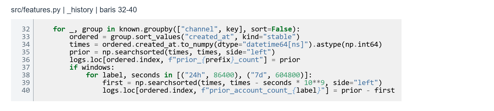

*Gambar 4.X Implementasi Pembentukan Riwayat Log dengan Prinsip Strict History.*

Cuplikan fungsi `_history` menunjukkan pengurutan waktu dan penggunaan `np.searchsorted(..., side="left")` untuk memperoleh jumlah observasi yang benar-benar lebih awal. Selisih posisi antara awal jendela dan batas waktu saat ini menghasilkan hitungan riwayat 24 jam dan tujuh hari. Nilai nol berarti tidak ada riwayat yang teramati, bukan pengisian nilai yang hilang.

#### Gambar A.2 — Pembentukan delapan fitur inti

Sumber: `src/features.py`; fungsi `build_features`; baris 121–130.

```python
    features = logs[["log_key", "channel"]].copy()
    features["log1p_amount"] = np.log1p(logs.amount.where(logs.amount.ge(0)))
    for count in ["prior_account_count_24h", "prior_account_count_7d", "prior_reference_count"]:
        features[f"log1p_{count}"] = np.log1p(logs[count])
    hour = logs.created_at.dt.hour + logs.created_at.dt.minute / 60 + logs.created_at.dt.second / 3600
    weekday = logs.created_at.dt.day_of_week
    for name, values, period in [("hour", hour, 24), ("weekday", weekday, 7)]:
        features[f"{name}_sin"] = np.sin(2 * np.pi * values / period)
        features[f"{name}_cos"] = np.cos(2 * np.pi * values / period)
    logs["core_features_eligible"] = np.isfinite(features[CORE_FEATURES].to_numpy(dtype=float)).all(axis=1)
```

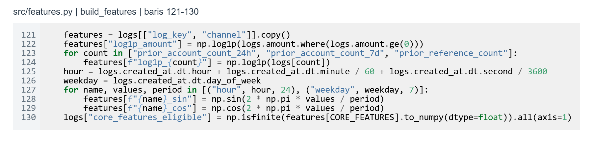

*Gambar 4.X Implementasi Pembentukan Delapan Fitur Log Transaksi.*

Kode dalam fungsi `build_features` memperlihatkan transformasi logaritmik dan pembentukan empat komponen waktu siklik. Pemeriksaan `np.isfinite` digunakan untuk memastikan seluruh nilai fitur layak menjadi input numerik. Artefak `feature_metadata.json` mencatat 14.261 log memiliki delapan fitur finite dan tidak ada log yang dikeluarkan dari model inti. Status pembatalan, identifier asli, data pribadi, kredensial, dan atribut katalog yang belum memiliki mapping tervalidasi tidak menjadi fitur model.

#### Gambar A.3 — Pemisahan kanal dan RobustScaler

Sumber: `src/modeling.py`; fungsi `run_models`; baris 174–184.

```python
    for channel, group in data.groupby("channel", sort=True):
        group = group.sort_values("log_key", kind="stable").reset_index(drop=True)
        if len(group) < 3:
            raise ValueError(f"Kanal {channel} memerlukan sedikitnya tiga log untuk eksperimen.")
        active = [c for c in feature_columns if group[c].nunique() > 1]
        constant = [c for c in feature_columns if c not in active]
        if not active:
            raise ValueError(f"Seluruh fitur konstan pada kanal {channel}; skor tidak dibuat.")
        scaler = RobustScaler()
        x = scaler.fit_transform(group[active].to_numpy(dtype=float))
        keys = group.log_key.to_numpy()
```

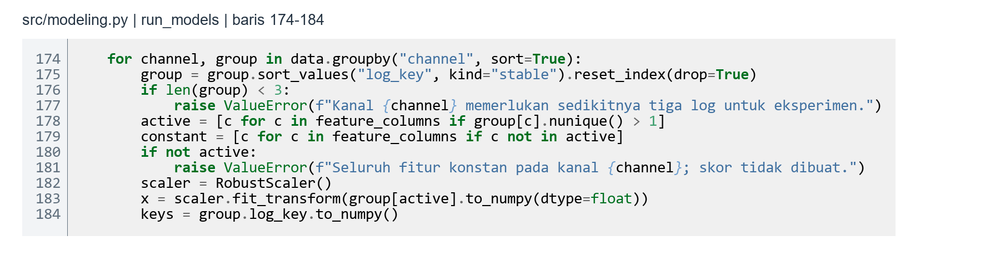

*Gambar 4.X Implementasi Pemisahan Kanal dan Penskalaan Fitur Menggunakan RobustScaler.*

Fungsi `run_models` membentuk kelompok per kanal, mengeluarkan fitur konstan jika ditemukan, kemudian menerapkan `RobustScaler`. Dengan konfigurasi default yang digunakan, scaler memusatkan fitur pada median dan menggunakan rentang antarkuartil sebagai skala, dengan penanganan skala nol oleh pustaka. Pada kedua kanal aktual, seluruh delapan fitur tetap aktif dan tidak ada fitur konstan. Scaler di-fit pada snapshot kanal yang sama dengan model, sehingga strict history pada fitur tidak menjadikan keseluruhan eksperimen sebagai evaluasi temporal.

#### Gambar B — Ringkasan fitur aktual

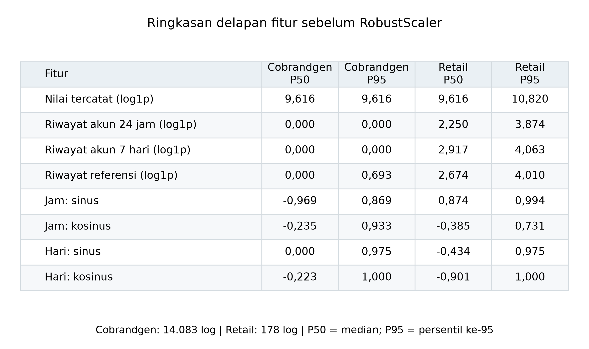

*Gambar 4.X Ringkasan Median dan Persentil ke-95 Delapan Fitur Sebelum Penskalaan.*

Gambar tersebut merupakan visualisasi dokumentasi tambahan yang dihitung dari artefak `data/processed/transaction_features.csv`, tanpa pembentukan ulang fitur atau fit model. Ringkasan disajikan sebelum RobustScaler agar nilai transformasinya tetap dapat ditelusuri. Angka komponen sinus dan kosinus menggambarkan posisi siklus; besarnya angka tersebut tidak secara langsung menyatakan tingkat risiko.

| Fitur | Cobrandgen P50 | Cobrandgen P95 | Retail P50 | Retail P95 |
| --- | --- | --- | --- | --- |
| `log1p_amount` | 9,6159 | 9,6159 | 9,6159 | 10,8198 |
| `log1p_prior_account_count_24h` | 0,0000 | 0,0000 | 2,2499 | 3,8743 |
| `log1p_prior_account_count_7d` | 0,0000 | 0,0000 | 2,9174 | 4,0630 |
| `log1p_prior_reference_count` | 0,0000 | 0,6931 | 2,6736 | 4,0100 |
| `hour_sin` | -0,9686 | 0,8688 | 0,8737 | 0,9945 |
| `hour_cos` | -0,2345 | 0,9332 | -0,3853 | 0,7315 |
| `weekday_sin` | 0,0000 | 0,9749 | -0,4339 | 0,9749 |
| `weekday_cos` | -0,2225 | 1,0000 | -0,9010 | 1,0000 |

Median fitur nilai tercatat pada kedua kanal sama, yaitu 9,6159 setelah transformasi log1p. Sebaliknya, median hitungan riwayat akun retail lebih tinggi daripada cobrandgen. Pada cobrandgen, median dan P95 hitungan 24 jam serta tujuh hari bernilai nol. Hasil ini menunjukkan perbedaan kepadatan riwayat yang teramati dan mendukung pemodelan kanal secara terpisah. Hitungan nol tidak membuktikan bahwa akun tidak mempunyai aktivitas di luar cakupan ekspor.

## 2. Tahap Pemodelan Anomali

### A. Penjelasan proses

Ketiga algoritma menerima matriks fitur hasil preprocessing untuk menghasilkan skor anomali per log. Isolation Forest memanfaatkan pemisahan acak untuk mengisolasi observasi; observasi yang lebih mudah diisolasi memperoleh indikasi anomali lebih kuat. ECOD menilai ketidaklaziman melalui ekor distribusi empiris fitur dan menggabungkan bukti antarfitur. LOF membandingkan kepadatan lokal suatu observasi dengan lingkungan tetangganya. Ketiganya memberikan sudut pandang yang berbeda terhadap snapshot data.

| Algoritma | Konfigurasi eksperimen aktual | Baseline dan orientasi skor |
| --- | --- | --- |
| Isolation Forest | `n_estimators` = 100/300; `max_samples` = 256/1.024 dibatasi jumlah log kanal; seed = 11/42/73; `contamination="auto"`. | Baseline 100 pohon, seed 11, `max_samples` 256 untuk cobrandgen dan 178 untuk retail. Skor = `-score_samples(x)`. |
| ECOD | `ECOD(n_jobs=1)`; satu konfigurasi snapshot per kanal; tidak ada variasi seed semu. | Skor = `decision_scores_` dari hasil fit. Threshold internal ECOD tidak menentukan prioritas investigasi. |
| Local Outlier Factor | `n_neighbors` = 10/20/50; `novelty=False`; `contamination="auto"`. | Baseline k = 10. Skor = `-negative_outlier_factor_` pada observasi fit. |

Konfigurasi berasal dari `configs/experiments.json` dan parameter efektif tercatat pada `outputs/tables/experiment_parameters.csv`. Cobrandgen mempunyai 12 varian IF, satu ECOD, dan tiga LOF, sehingga totalnya 16 eksperimen. Retail mempunyai enam varian IF, satu ECOD, dan tiga LOF, sehingga totalnya 10 eksperimen. Jumlah varian IF retail lebih sedikit karena kedua pilihan `max_samples` dibatasi menjadi 178 dan kombinasi identik hanya dijalankan sekali. Baseline adalah konfigurasi pertama, bukan model yang dipilih berdasarkan label akurasi.

### B. Cuplikan kode dan dokumentasi

#### Gambar C.1 — Isolation Forest

Sumber: `src/modeling.py`; fungsi `run_models`; baris 205–213.

```python
        for trees, samples, seed in if_variants:
            model = IsolationForest(n_estimators=trees, max_samples=samples, random_state=seed, contamination="auto")
            model.fit(x)
            score = -model.score_samples(x)
            label = f"trees={trees};max_samples={samples};seed={seed}"
            if_models.append((model, score, label))
            channel_parameters.append({"channel": channel, "model": "if", "variant": label,
                                       "n_estimators": trees, "max_samples": samples, "seed": seed,
                                       "baseline": len(if_models) == 1})
```

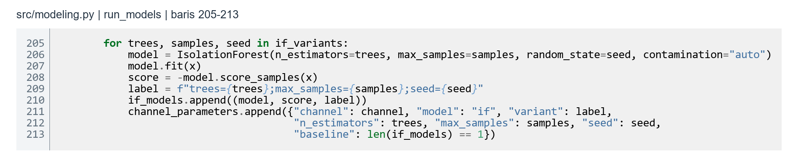

*Gambar 4.X Implementasi Pelatihan dan Perhitungan Skor Isolation Forest.*

Cuplikan memperlihatkan inisialisasi model dari grid parameter, proses fit, dan pembalikan tanda `score_samples`. Orientasi skor diseragamkan sehingga skor lebih besar menunjukkan observasi yang lebih tidak biasa menurut model. `contamination="auto"` tidak digunakan sebagai aturan kuota investigasi; kuota dihitung kemudian dari peringkat konsensus.

#### Gambar C.2 — ECOD

Sumber: `src/modeling.py`; fungsi `run_models`; baris 214–218.

```python
        ecod = ECOD(n_jobs=1)
        ecod.fit(x)
        ecod_score = ecod.decision_scores_.copy()
        channel_parameters.append({"channel": channel, "model": "ecod", "variant": "empirical_snapshot",
                                   "baseline": True, "threshold_used_for_priority": False})
```

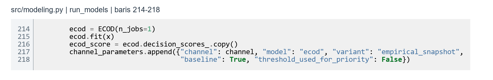

*Gambar 4.X Implementasi Pelatihan dan Pengambilan Skor ECOD.*

Model ECOD di-fit pada fitur kanal dan skor disalin dari `decision_scores_`. Dalam implementasi pustaka yang digunakan, bukti ekor distribusi empiris dievaluasi per fitur lalu digabungkan. Penggunaan skor hasil fit ini sesuai protokol snapshot proyek. Belum tersedia evaluasi ECOD pada data masa depan dengan distribusi referensi yang dibekukan.

#### Gambar C.3 — Local Outlier Factor

Sumber: `src/modeling.py`; fungsi `run_models`; baris 223–226.

```python
            model = LocalOutlierFactor(n_neighbors=neighbors, novelty=False, contamination="auto")
            with warnings.catch_warnings(record=True) as captured:
                warnings.simplefilter("always")
                model.fit(x)
```

Sumber: `src/modeling.py`; fungsi `run_models`; baris 237–240.

```python
            score = -model.negative_outlier_factor_
            label = f"requested_k={requested_neighbors};n_neighbors={neighbors};novelty=False"
            if not any(previous.n_neighbors == neighbors for previous, _, _ in lof_models):
                lof_models.append((model, score, label))
```

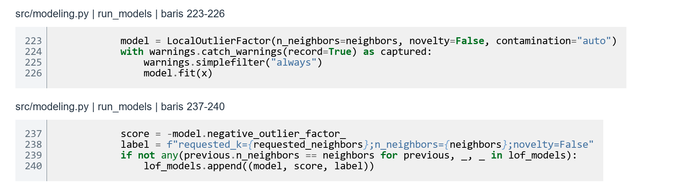

*Gambar 4.X Implementasi Pelatihan dan Perhitungan Skor Local Outlier Factor.*

Gambar menggunakan dua panel dengan rentang baris yang terpisah. Baris 227–236 yang berada di antaranya tetap ada dalam source code dan memeriksa warning serta kelayakan hasil fit; panel tidak disambungkan seolah-olah merupakan satu blok kontigu. Nilai `neighbors` ditentukan pada baris 220–222 dengan batas ukuran kanal dan pengaman blok vektor identik. Pada hasil aktual, k efektif tetap 10, 20, dan 50 tanpa warning hasil tidak valid. Vektor identik dipertahankan, tanpa jitter atau deduplikasi.

Penggunaan `novelty=False` berarti LOF menilai observasi yang dipakai saat fit. Pembalikan tanda `negative_outlier_factor_` menyelaraskan arah skor dengan dua algoritma lain. Perubahan jumlah tetangga mengubah skala lingkungan lokal yang dibandingkan, sehingga pengaruhnya diperiksa melalui evaluasi stabilitas.

#### Gambar D — Distribusi skor anomali

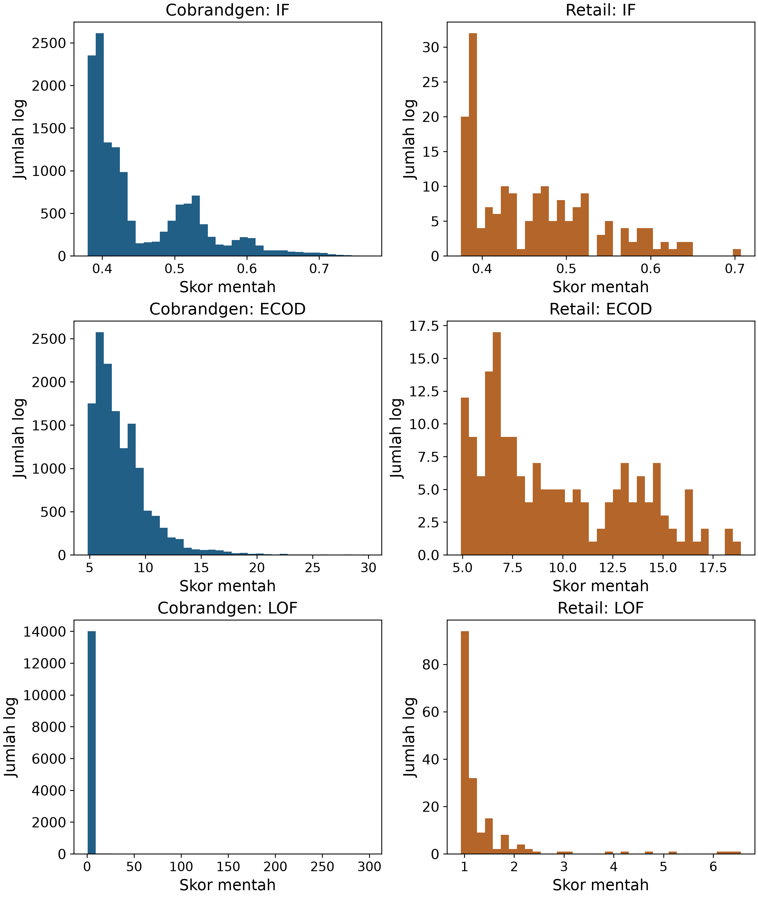

*Gambar 4.X Distribusi Skor Anomali Isolation Forest, ECOD, dan LOF pada Masing-Masing Kanal.*

Gambar merupakan versi tata letak A4 dari `outputs/figures/08_model_score_distributions.png`. Histogram memakai skor baseline tersimpan dan 35 bin pada rentang penuh, sama seperti grafik sumber, tanpa fit ulang atau perubahan nilai skor. Susunan panel menjadi dua kolom dan tiga baris agar tulisan lebih terbaca. [Salinan gambar asli](assets/model_score_distributions.png) juga disertakan.

| Kanal | Model | Median skor | P95 skor | Maksimum skor |
| --- | --- | --- | --- | --- |
| Cobrandgen | IF | 0,4195 | 0,6041 | 0,7670 |
| Cobrandgen | ECOD | 7,1986 | 12,5241 | 29,9307 |
| Cobrandgen | LOF | 1,0247 | 1,5667 | 298,1919 |
| Retail | IF | 0,4509 | 0,6006 | 0,7070 |
| Retail | ECOD | 8,7886 | 16,2348 | 18,8879 |
| Retail | LOF | 1,0727 | 2,5670 | 6,5546 |

Distribusi IF berada pada rentang yang lebih sempit, sedangkan ECOD mempunyai skala mentah yang berbeda. LOF cobrandgen memiliki ekor panjang: median 1,0247, P95 1,5667, dan maksimum 298,1919. Akibatnya, sebagian besar histogram LOF cobrandgen tampak terkumpul di sisi kiri ketika seluruh rentang ditampilkan. Skor maksimum LOF retail adalah 6,5546. Perbedaan rentang ini merupakan sifat keluaran model pada snapshot yang diuji, bukan ukuran keunggulan atau akurasi. Skor mentah tidak dibandingkan langsung antarmodel maupun antarkanal.

## 3. Tahap Evaluasi dan Perbandingan Model

### A. Penjelasan proses

Evaluasi dilakukan tanpa ground-truth anomaly labels dengan membandingkan peringkat pada observasi yang sama. Spearman mengukur hubungan peringkat skor secara keseluruhan. Top-K overlap mengukur proporsi irisan dua himpunan log teratas, yaitu `|A ∩ B| / K`, sedangkan Jaccard menggunakan `|A ∩ B| / |A ∪ B|`. K yang diuji adalah 10, 25, dan 50. Stabilitas memeriksa perubahan peringkat akibat variasi parameter/seed serta subsampel pelatihan IF. Konsensus kemudian membentuk antrean investigasi dari rerata persentil model.

### B. Cuplikan kode dan dokumentasi

#### Implementasi metrik evaluasi

Sumber: `src/modeling.py`; fungsi `_correlation`; baris 45–49.

```python
def _correlation(left, right):
    if np.ptp(left) == 0 or np.ptp(right) == 0:
        return None
    value = float(spearmanr(left, right).statistic)
    return value if np.isfinite(value) else None
```

Sumber: `src/modeling.py`; fungsi `_comparison`; baris 52–60.

```python
def _comparison(left, right, keys, requested_k):
    k = min(int(requested_k), len(left))
    a = set(np.flatnonzero(_ordinal_ranks(left, keys) <= k))
    b = set(np.flatnonzero(_ordinal_ranks(right, keys) <= k))
    return {
        "k_requested": int(requested_k), "k_effective": k,
        "intersection_count": len(a & b), "top_k_overlap": len(a & b) / k,
        "jaccard": len(a & b) / len(a | b), "spearman": _correlation(left, right),
    }
```

Fungsi `_correlation` menghitung Spearman dan menangani vektor konstan, sedangkan `_comparison` membentuk dua himpunan Top-K serta menghitung irisan, overlap, dan Jaccard. Korelasi menggunakan average ranks untuk skor yang sama. Pemilihan tepat K log menggunakan `_ordinal_ranks` pada `src/modeling.py`, baris 38–42, dengan `log_key` sebagai pemecah tie deterministik. Pemecah tie tersebut tidak membawa arti risiko bisnis.

#### Gambar E — Perbandingan hasil model

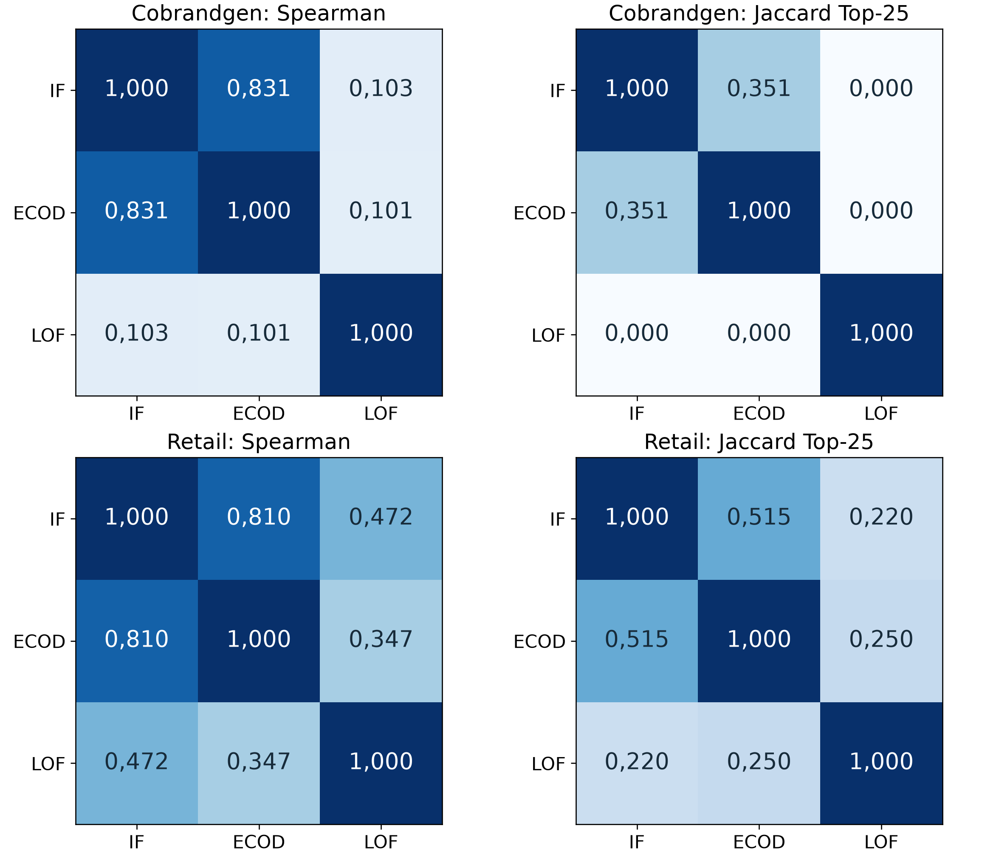

*Gambar 4.X Perbandingan Kesesuaian Peringkat Model Berdasarkan Spearman dan Jaccard Top-25.*

Versi dokumentasi ini menggambar ulang matriks pada `outputs/figures/09_model_agreement.png` dari `outputs/tables/model_agreement.csv` dengan filter `k_requested == 25`. Seluruh nilai matriks dipertahankan; ukuran font diperbesar. [Gambar asli](assets/model_agreement.png) tersedia sebagai pembanding.

| Kanal | Pasangan | Spearman | Irisan Top-25 | Overlap Top-25 | Jaccard Top-25 |
| --- | --- | --- | --- | --- | --- |
| Cobrandgen | IF–ECOD | 0,8309 | 13/25 | 0,5200 | 0,3514 |
| Cobrandgen | IF–LOF | 0,1028 | 0/25 | 0,0000 | 0,0000 |
| Cobrandgen | ECOD–LOF | 0,1012 | 0/25 | 0,0000 | 0,0000 |
| Retail | IF–ECOD | 0,8100 | 17/25 | 0,6800 | 0,5152 |
| Retail | IF–LOF | 0,4717 | 9/25 | 0,3600 | 0,2195 |
| Retail | ECOD–LOF | 0,3469 | 10/25 | 0,4000 | 0,2500 |

IF dan ECOD memperlihatkan kesesuaian peringkat relatif tinggi, dengan Spearman 0,8309 pada cobrandgen dan 0,8100 pada retail. Namun, kesesuaian global tersebut tidak menghasilkan daftar teratas yang identik: irisannya hanya 13 dari 25 log cobrandgen dan 17 dari 25 log retail. Pada cobrandgen, IF–LOF dan ECOD–LOF tidak beririsan dalam Top-25. Perbedaan tersebut menunjukkan perlunya meninjau log yang ditonjolkan oleh sudut pandang model berbeda. Agreement tidak menunjukkan persentase deteksi yang benar. K yang sama juga mempunyai proporsi populasi berbeda pada dua kanal.

#### Gambar F — Stabilitas model

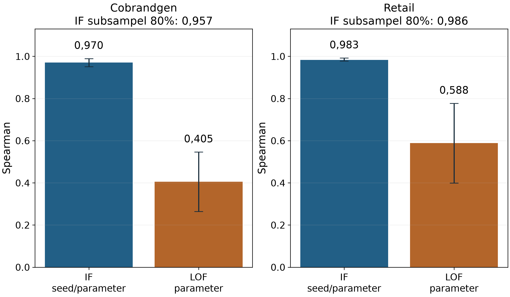

*Gambar 4.X Perbandingan Stabilitas Peringkat Isolation Forest dan Local Outlier Factor.*

Grafik mengacu pada `outputs/figures/10_model_stability.png` dan digambar ulang dari `model_stability.csv` dengan font untuk A4. Batang menunjukkan rerata Spearman terhadap baseline, sedangkan garis menunjukkan minimum–maksimum varian, bukan confidence interval. Pengulangan metrik pada K = 10, 25, dan 50 tidak dianggap sebagai eksperimen independen; ringkasan menggunakan varian unik. [Gambar asli](assets/model_stability.png) disertakan.

| Kanal | Model | Perbandingan baseline | Mean Spearman | Minimum | Maksimum |
| --- | --- | --- | --- | --- | --- |
| Cobrandgen | IF | 11 | 0,9701 | 0,9506 | 0,9892 |
| Cobrandgen | LOF | 2 | 0,4052 | 0,2644 | 0,5460 |
| Retail | IF | 5 | 0,9831 | 0,9773 | 0,9918 |
| Retail | LOF | 2 | 0,5880 | 0,3992 | 0,7767 |

IF lebih konsisten pada grid yang diuji daripada LOF. Mean Spearman IF adalah 0,9701 dan 0,9831, sedangkan LOF adalah 0,4052 dan 0,5880 untuk cobrandgen dan retail. Variasi IF mencakup seed, jumlah pohon, dan `max_samples`; variasi LOF hanya mengubah k. Oleh sebab itu, perbandingan ini dibatasi pada rancangan eksperimen aktual dan tidak menetapkan algoritma yang paling akurat. ECOD tidak diberi pengulangan seed semu.

Implementasi perbandingan parameter/seed terdapat pada `src/modeling.py`, fungsi `run_models`, baris 274–281. Cuplikan berikut menunjukkan protokol subsampel IF yang terpisah.

Sumber: `src/modeling.py`; fungsi `run_models`; baris 282–298.

```python
        sample_performed = 0 < sample_fraction < 1 and math.floor(sample_fraction * len(group)) >= 3
        if sample_performed:
            rng = np.random.default_rng(int(seeds[0]))
            sample_indices = rng.choice(len(group), size=math.floor(sample_fraction * len(group)), replace=False)
            sample_scaler = RobustScaler()
            sample_scaler.fit(group.iloc[sample_indices][active].to_numpy(dtype=float))
            sample_x = sample_scaler.transform(group[active].to_numpy(dtype=float))
            trees, samples, seed = if_variants[0]
            sample_model = IsolationForest(n_estimators=trees, max_samples=min(samples, len(sample_indices)),
                                           random_state=seed, contamination="auto")
            sample_model.fit(sample_x[sample_indices])
            sample_score = -sample_model.score_samples(sample_x)
            for k in top_ks:
                stability.append({"channel": channel, "model": "if", "comparison": "subsample_training",
                                  "baseline_variant": if_models[0][2], "variant": f"fraction={sample_fraction}",
                                  "reference_rows": len(group), "sample_train_rows": len(sample_indices),
                                  **_comparison(raw_scores["if"], sample_score, keys, k)})
```

| Kanal | Log subset train | Log referensi scoring | Spearman terhadap baseline | Irisan Top-25 |
| --- | --- | --- | --- | --- |
| Cobrandgen | 11.266 | 14.083 | 0,9573 | 20/25 |
| Retail | 142 | 178 | 0,9862 | 22/25 |

Uji subsampel memilih 80% log tanpa pengembalian. Scaler dan IF di-fit pada subset, kemudian seluruh snapshot kanal yang sama diberi skor sebagai referensi perbandingan. Spearman yang diperoleh adalah 0,9573 pada cobrandgen dan 0,9862 pada retail. Referensi scoring masih tumpang tindih dengan data train; hasil ini merupakan pengukuran sensitivitas subsampel, bukan performa holdout atau generalisasi temporal.

#### Gambar G — Konsensus dan prioritas investigasi

Sumber: `src/modeling.py`; fungsi `run_models`; baris 252–263.

```python
        result = group[["log_key", "channel"]].copy()
        for name, values in raw_scores.items():
            result[f"{name}_score"] = values
            result[f"{name}_percentile"] = pd.Series(values).rank(method="average", pct=True)
            result[f"{name}_rank"] = pd.Series(values).rank(method="average", ascending=False)
        result["consensus_score"] = result[[f"{name}_percentile" for name in MODEL_NAMES]].mean(axis=1)
        result["anomaly_rank"] = _ordinal_ranks(result.consensus_score.to_numpy(), keys)
        high_count, medium_count = math.ceil(len(group) * .01), math.ceil(len(group) * .05)
        result["investigation_priority"] = np.select(
            [result.anomaly_rank <= high_count, result.anomaly_rank <= medium_count],
            ["tinggi", "sedang"], default="rendah",
        )
```

Persentil setiap model dihitung sebagai average rank skor menaik dibagi jumlah log kanal. Skor konsensus merupakan rerata tiga persentil tersebut dengan bobot sama; hasil rerata tidak diberi peringkat persentil ulang. Antrean ditentukan oleh peringkat konsensus, dengan prioritas tinggi sebanyak `ceil(0,01 × n)`, prioritas sedang sampai kumulatif `ceil(0,05 × n)`, dan sisanya rendah. Konsensus merupakan aturan penggabungan peringkat, bukan model terlatih keempat atau probabilitas fraud.

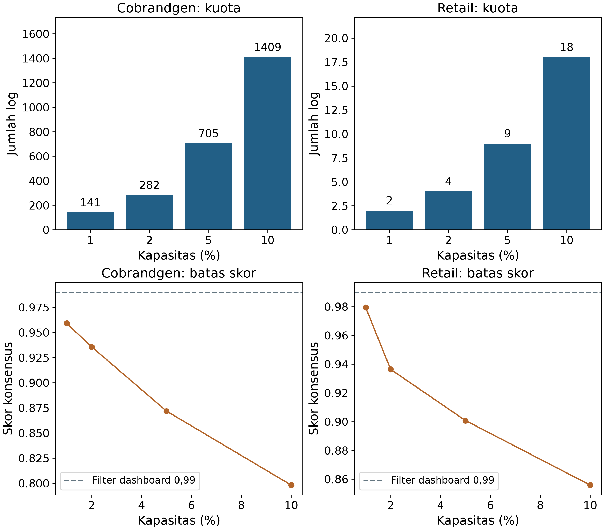

*Gambar 4.X Analisis Sensitivitas Kapasitas Investigasi dan Ambang Skor Konsensus.*

Gambar merupakan versi A4 dari `outputs/figures/11_threshold_sensitivity.png`, menggunakan baris `model == 'consensus'` pada `threshold_sensitivity.csv`. Panel atas memperlihatkan jumlah log yang dipilih menurut kuota, sedangkan panel bawah menunjukkan skor pada batas kuota. Jumlah terpilih merupakan konsekuensi mekanis asumsi kapasitas. [Salinan gambar asli](assets/threshold_sensitivity.png) tetap tersedia.

| Kanal | Jumlah log | Tinggi | Sedang | Rendah |
| --- | --- | --- | --- | --- |
| Cobrandgen | 14.083 | 141 | 564 | 13.378 |
| Retail | 178 | 2 | 7 | 169 |
| Total | 14.261 | 143 | 571 | 13.547 |

Kuota prioritas tinggi menghasilkan 141 log cobrandgen dan dua log retail, sehingga totalnya 143 log. Angka tersebut merupakan antrean pemeriksaan, bukan 143 transaksi fraud yang terbukti. Prioritas sedang berjumlah 571 log, sedangkan 13.547 log berada pada prioritas rendah. Penetapan rendah juga tidak membuktikan bahwa log bebas masalah.

| Kanal | Kapasitas | Jumlah terpilih | Skor pada batas kuota |
| --- | --- | --- | --- |
| Cobrandgen | 1% | 141 | 0,9590 |
| Cobrandgen | 2% | 282 | 0,9357 |
| Cobrandgen | 5% | 705 | 0,8718 |
| Cobrandgen | 10% | 1.409 | 0,7981 |
| Retail | 1% | 2 | 0,9794 |
| Retail | 2% | 4 | 0,9363 |
| Retail | 5% | 9 | 0,9007 |
| Retail | 10% | 18 | 0,8558 |

Kuota peringkat perlu dibedakan dari filter skor pada dashboard. Pada threshold konsensus 0,99, yang memenuhi filter hanya 10 log cobrandgen dan nol retail, meskipun kuota tinggi tetap 141 dan dua log. Maksimum konsensus retail adalah 0,9831460674. Perbedaan timbul dari definisi rerata persentil, kuota ordinal, dan penanganan ties; bukan bukti ada atau tidak adanya fraud.

### C. Pembahasan hasil dan keterbatasan

Hasil eksperimen mendukung penggunaan IF sebagai baseline retrospektif yang stabil pada grid pengujian, dengan ECOD sebagai pembanding yang relatif selaras. LOF memberikan informasi kepadatan lokal yang berbeda, tetapi lebih sensitif terhadap jumlah tetangga. Konsensus dapat membantu menyusun antrean awal, sambil mempertahankan pemeriksaan terhadap kasus yang hanya ditonjolkan satu model. Keputusan bisnis tetap memerlukan konfirmasi konteks proses dan hasil tinjauan analis.

Label anomali tervalidasi belum tersedia. Dengan demikian, accuracy, precision, recall, F1, dan ROC-AUC pada anomali nyata tidak dihitung. Implementasi temporal holdout, ECOD dengan referensi distribusi beku untuk penilaian masa depan, LOF novelty untuk observasi baru, serta stress test sintetis belum tersedia sebagai hasil eksperimen. Model akun juga belum diterapkan. Keterbatasan tersebut membatasi klaim pada konsistensi snapshot dan dukungan investigasi.

## Referensi implementasi dan ketertelusuran

Nomor baris merujuk pada source code lokal saat dokumentasi dibuat. Cuplikan di atas diambil langsung dari rentang sumber, mempertahankan isi dan indentasi, tanpa pseudocode. Gambar kode dirender dengan syntax highlighting dan tidak ditampilkan sebagai screenshot VS Code. Berkas gambar asli hasil eksperimen disalin tanpa perubahan; gambar dengan akhiran `_a4` merupakan rendering dokumentasi dari nilai artefak yang sama.

| Proses | Berkas sumber | Fungsi / lokasi | Baris |
| --- | --- | --- | --- |
| Urutan pipeline | [run_pipeline.py](../../run_pipeline.py) | `run_pipeline` | 12–35 |
| Daftar delapan fitur | [src/features.py](../../src/features.py) | `CORE_FEATURES`, tingkat modul | 12–15 |
| Strict history | [src/features.py](../../src/features.py) | `_history` | 32–40 |
| Transformasi fitur | [src/features.py](../../src/features.py) | `build_features` | 121–130 |
| Pemisahan kanal dan scaler | [src/modeling.py](../../src/modeling.py) | `run_models` | 174–184 |
| Grid dan batas parameter IF | [src/modeling.py](../../src/modeling.py) | `run_models` | 196–199 |
| IF fit/skor | [src/modeling.py](../../src/modeling.py) | `run_models` | 205–213 |
| ECOD fit/skor | [src/modeling.py](../../src/modeling.py) | `run_models` | 214–218 |
| Pengaman tetangga LOF | [src/modeling.py](../../src/modeling.py) | `run_models` | 220–222 |
| LOF fit dan skor, dua panel | [src/modeling.py](../../src/modeling.py) | `run_models` | 223–226; 237–240 |
| Warning LOF yang tidak ditampilkan pada panel | [src/modeling.py](../../src/modeling.py) | `run_models` | 227–236 |
| Pemecah ties ordinal | [src/modeling.py](../../src/modeling.py) | `_ordinal_ranks` | 38–42 |
| Spearman | [src/modeling.py](../../src/modeling.py) | `_correlation` | 45–49 |
| Top-K overlap dan Jaccard | [src/modeling.py](../../src/modeling.py) | `_comparison` | 52–60 |
| Stabilitas parameter/seed | [src/modeling.py](../../src/modeling.py) | `run_models` | 274–281 |
| Stabilitas subsampel IF | [src/modeling.py](../../src/modeling.py) | `run_models` | 282–298 |
| Persentil, konsensus, prioritas | [src/modeling.py](../../src/modeling.py) | `run_models` | 252–263 |
| Sensitivitas kuota | [src/modeling.py](../../src/modeling.py) | `run_models` | 300–309 |
| Histogram asli | [src/reporting.py](../../src/reporting.py) | `write_results` | 82–88 |
| Grafik agreement asli | [build_knowledge_evidence.py](../../build_knowledge_evidence.py) | `agreement_figure` | 27–44 |
| Grafik stabilitas asli | [build_knowledge_evidence.py](../../build_knowledge_evidence.py) | `stability_figure` | 47–61 |
| Grafik sensitivitas asli | [build_knowledge_evidence.py](../../build_knowledge_evidence.py) | `threshold_figure` | 64–78 |

Sumber hasil: [parameter eksperimen](../../outputs/tables/experiment_parameters.csv), [agreement](../../outputs/tables/model_agreement.csv), [stabilitas](../../outputs/tables/model_stability.csv), [sensitivitas kuota](../../outputs/tables/threshold_sensitivity.csv), [ringkasan skor](../../outputs/tables/score_summary.csv), [jumlah pada threshold dashboard](../../outputs/tables/dashboard_threshold_counts.csv), dan [metadata evaluasi](../../outputs/reports/model_evaluation.json). Interpretasi diselaraskan dengan [knowledge hasil dan pembahasan](../KNOWLEDGE_HASIL_DAN_PEMBAHASAN.md), terutama bagian fitur, protokol model, agreement, stabilitas, dan konsensus.

Artefak fitur dan skor per log hanya dibaca secara lokal untuk menghasilkan ringkasan/grafik. Dokumen dan aset tidak memuat baris transaksi, identifier operasional, atau kredensial. Daftar gambar, sumber data, ukuran PNG, dan saran penempatan di Word tersedia pada [dokumentasi gambar](dokumentasi_gambar.md).
